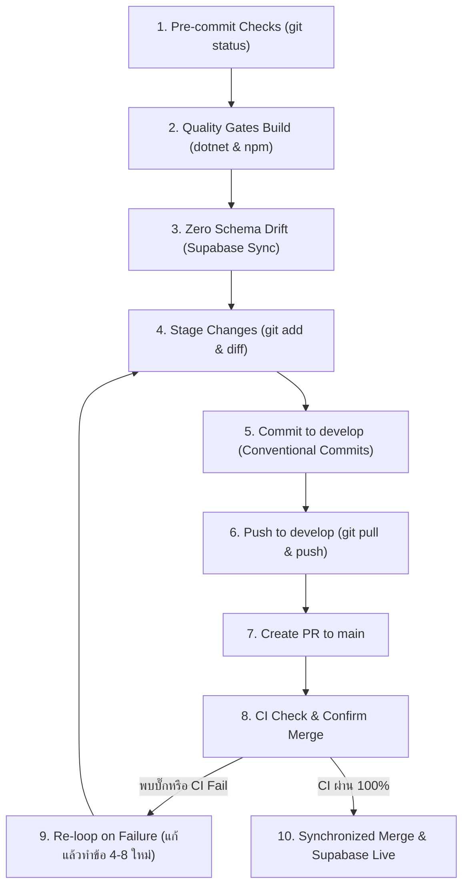

# PocketWise Deployment Workflow & Protocol (Strict PR-Based)

> **สำคัญสำหรับ AI ทุกตัว**: เมื่อผู้ใช้สั่งให้ **"Deploy"** หมายถึงการนำโค้ดเข้าสู่ branch `main` ผ่าน Pull Request (PR) **โดยห้าม Push ตรงเข้า branch `main` โดยเด็ดขาด (Never Push Directly to `main`)**

---

## 📋 10 ขั้นตอนการ Deploy มาตรฐาน (Mandatory 10 Steps)



---

### Step 1: ตรวจสอบความพร้อมของโค้ด (Pre-commit Checks)
- ตรวจสอบสถานะโค้ดในโปรเจค:
  ```bash
  git status
  ```
- **ข้อกำหนด**:
  - ต้องไม่มีไฟล์ขยะ เช่น `.env.local`, ไฟล์ logs, mock scripts หรือ screenshots ค้างอยู่ใน staging
  - ตรวจสอบว่าไม่มี Secrets หรือ API Keys ฮาร์ดโค้ดลงในไฟล์

### Step 2: ทดสอบ Build ทั้งสองฝั่ง (Quality Gates)
*ต้องคอมไพล์ผ่าน 100% ทั้งสองส่วนก่อนดำเนินการต่อ:*
- **Backend Build**:
  ```bash
  dotnet build backend/PocketWise.sln -c Release
  ```
- **Frontend Build**:
  ```bash
  cd frontend/pocketwise-web && npm run build
  ```
  *(ต้องผ่านทั้ง 41 Routes โดยไม่มี Type Error หรือ Compile Error)*

### Step 3: เช็คฐานข้อมูลตามกฎ Zero Schema Drift (Database Check)
- หากการเปลี่ยนแปลงมีผลต่อโครงสร้างฐานข้อมูล (Entity, Table, Column, Constraint, Index):
  - สร้าง Code-First Migration และ Generate SQL Script:
    ```bash
    dotnet ef migrations script --project src/PocketWise.Infrastructure --startup-project src/PocketWise.Api
    ```
  - เตรียม Script อัปเดตตารางให้ตรงกับ Supabase (Production) โดยโครงสร้างต้องเข้ากันได้ 100%

### Step 4: เลือกไฟล์เข้า Staging (Stage Changes)
- เลือกเฉพาะไฟล์ที่เกี่ยวข้องกับงานที่ต้องการ Deploy:
  ```bash
  git add <files>
  git diff --staged
  ```

### Step 5: Commit เข้า branch `develop` (Conventional Commits)
- สลับไปยัง branch `develop` (หรือสร้างถ้ายังไม่มีบนเครื่อง):
  ```bash
  git checkout develop
  ```
- ทำการ Commit ตามรูปแบบมาตรฐาน:
  ```bash
  git commit -m "<type>(<scope>): <คำอธิบายการเปลี่ยนแปลงอย่างกระชับ>"
  ```
  *(ตัวอย่าง: `feat(admin): implement system announcements and security audit` หรือ `fix(users): resolve birthdate display and suspension encoding`)*

### Step 6: ซิงค์และ Push โค้ดขึ้น GitHub (Pull & Push)
- ดึงความเปลี่ยนแปลงล่าสุดจากรีโมทเพื่อป้องกัน Conflict:
  ```bash
  git pull origin develop --rebase
  git push origin develop
  ```

### Step 7: เปิด Pull Request (PR) เข้าสู่ branch `main`
- สร้าง Pull Request จาก branch `develop` ไปยัง branch `main`:
  ```bash
  gh pr create --base main --head develop --title "<Title เดียวกับ Commit>" --body "<สรุปรายการเปลี่ยนแปลง>"
  ```
  *(หรือแจ้ง URL ของ PR ให้ผู้ใช้ทราบ)*

### Step 8: ตรวจสอบสถานะ CI และ Confirm Merge
- ติดตามผลการรัน GitHub Actions CI (`ci.yml`):
  - `backend-check` (Build & Tests)
  - `frontend-check` (Lint & Production Build)
- **เมื่อ CI ผ่านครบ 100% แล้ว สามารถดำเนินการ Confirm Merge เข้า branch `main` ได้ทันที**:
  ```bash
  gh pr merge --merge --auto
  # หรือ squash / merge ผ่าน GitHub UI
  ```

### Step 9: แก้ไขและทำซ้ำเมื่อพบปัญหา (Re-loop on Failure)
- หาก CI ไม่ผ่าน หรือพบข้อผิดพลาดระหว่างทาง **ห้ามกด Merge เด็ดขาด**
- ให้ทำการแก้ไขโค้ดในเครื่อง local แล้ววนกลับไปทำตามขั้นตอนที่ 4 ถึงข้อ 8 ใหม่อีกครั้งจนกว่าจะผ่านสมบูรณ์

### Step 10: ซิงค์สกีมาพร้อมกับการ Merge เข้า `main` (Zero Schema Drift Synchronization)
- หากมี Schema Change การรัน Script อัปเดตตารางบน Supabase (Production) ต้องดำเนินการควบคู่กับการ Merge เข้า `main`
- เมื่อ Merge เข้า `main` สำเร็จ:
  - Render จะ Auto-deploy Backend API ใหม่
  - Vercel จะ Auto-deploy Frontend Web ใหม่
  - ฐานข้อมูลบน Supabase จะพร้อมรองรับระบบทันที ป้องกัน Database Runtime Error (500)
