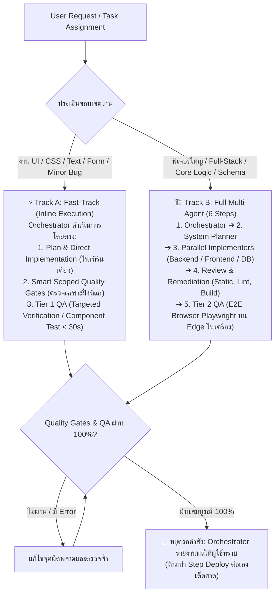

# PocketWise Agile Dual-Track Execution & Quality Gates Workflow

> **สำคัญสำหรับ AI Assistant**: เอกสารนี้กำหนดกระบวนการเลือกโหมดการทำงาน การควบคุมคุณภาพ (Quality Gates) และการทดสอบระบบก่อนส่งมอบ

---

## ⚡ 1. การเลือกโหมดการทำงาน (Dual-Track Selection Protocol)

### Track A: Fast-Track / Direct Inline Execution
- **ขอบเขต**: งาน UI, ปรับแต่ง Layout/CSS, แก้ไขข้อความ/Text, ปรับฟอร์ม, จัดการ Component ซ้ำซ้อน, Bug Fix ทั่วไป
- **วิธีปฏิบัติ**: Orchestrator (Parent Agent) ดำเนินการแก้ไขและทดสอบแบบ Inline ทันที **ไม่ต้องแตก Subagent ลูกโซ่ 5-6 ตัว** เพื่อขจัดเวลาหน่วงและจบงานได้ภายใน 3–8 นาที
- **การทดสอบ**: ตรวจเฉพาะจุดที่แก้ไขและรัน Smart Scoped Quality Gates

### Track B: Full Multi-Agent Architecture
- **ขอบเขต**: Feature ใหม่ขนาดใหญ่, สถาปัตยกรรมระบบหลัก, ระบบความปลอดภัย/Auth, หรือการเปลี่ยน Data Model/Schema
- **วิธีปฏิบัติ**: ดำเนินการตาม 6 ขั้นตอน:
  1. **Orchestrator**: วิเคราะห์ภาพรวม ควบคุมทิศทาง และสื่อสารกับผู้ใช้เป็นภาษาไทย
  2. **System Planner Subagent**: กำหนด Data Contracts (API Request/Response DTOs) และวาง Test Scenarios
  3. **Parallel Implementers Subagents**: แยกพัฒนา Backend, Frontend, DB คู่ขนานพร้อมกัน สื่อสารเป็นภาษาอังกฤษ 100%
  4. **Review & Remediation Subagent**: รวมผลงานและตรวจความถูกต้องของสถาปัตยกรรมและ Build
  5. **QA Browser Testing Subagent**: รันการทดสอบเบราว์เซอร์อัตโนมัติ
  6. **DevOps & Deployment**: ทำเฉพาะเมื่อได้รับคำสั่ง Deploy จากผู้ใช้เท่านั้น

---

## 🌐 2. กฎภาษาในการสื่อสาร (Language Protocol)

- **Agent-to-Agent Communication (ใน Track B)**: การส่งคำสั่ง บรีฟ มอบหมายงาน และสนทนาระหว่าง Subagent ด้วยกัน **ต้องใช้ภาษาอังกฤษ (English) 100%** เพื่อความแม่นยำ กระชับ และประสิทธิภาพสูงสุด
- **User Communication**: เมื่อ Orchestrator สื่อสารกับผู้ใช้ (รายงานผล, สรุปงาน, ถามคำถาม) **ต้องใช้ภาษาไทย (Thai) เสมอ**

---

## 🛡️ 3. การตรวจสอบคุณภาพแบบเฉพาะจุด (Smart Scoped Quality Gates)

- **เมื่อแก้เฉพาะ Frontend**:
  - ตรวจสอบเฉพาะ `npm run lint` และ `npm run build` (หรือ `npx tsc --noEmit`)
  - **ห้าม** ไปรัน `dotnet build` หรือ `dotnet test` ข้ามฝั่งให้เสียเวลา
- **เมื่อแก้เฉพาะ Backend**:
  - ตรวจสอบเฉพาะ `dotnet build backend/PocketWise.sln -c Release` และ `dotnet test`
  - **ห้าม** ไปรัน Next.js build ข้ามฝั่ง
- **เมื่อแก้ Full-Stack หรือช่วงสุดท้ายก่อน Merge PR**:
  - รันตรวจสอบทั้งสองฝั่งครบถ้วน 100%

---

## 🧪 4. มาตรฐานการทดสอบ QA Step 5 แบบแบ่งระดับ (Tiered QA Protocol)

### Tier 1 (UI, Copy, Styling, Minor Layout, Animation, Gesture)
- ใช้ **Targeted Verification / Component Test / Headless Snapshot Check**
- ตรวจสอบเฉพาะ Component หรือหน้าที่ได้รับผลกระทบ ใช้เวลา < 30 วินาที
- ห้ามเขียน script ยาววนเปิดครบทุกหน้าในระบบโดยไม่จำเป็น

### Tier 2 (Core Business Logic, Database Transaction, Slip OCR, Auth, Payment)
- ใช้ **Playwright E2E Browser Testing** ทดสอบ Flow ทำงานจริงทั้ง Error Cases และ Happy Path
- **กฎเหล็กเรื่อง Browser Binary (Zero External Browser Download Policy)**:
  - ในขั้นตอน QA ด้วย Playwright **ต้องใช้ Browser binary ที่มีอยู่แล้วในเครื่องเท่านั้น (เช่น `channel: 'msedge'`)**
  - **ห้ามรันคำสั่ง `npx playwright install` หรือดาวน์โหลด binary จากภายนอกโดยเด็ดขาด** เพื่อป้องกันอาการ Network Timeout ค้าง

---

## 🛑 5. กฎเหล็กหยุดรอคำสั่ง (Mandatory Stop & Report)

- ในทุกงานพัฒนา AI ต้องดำเนินการถึงแค่ **Step 5 (QA Verification)** เท่านั้น
- เมื่อทดสอบผ่าน 100% แล้ว **ต้องหยุดและรายงานผลให้ผู้ใช้ทราบทันที ห้ามข้ามไปทำ Step 6 (Deploy/PR) โดยเด็ดขาดจนกว่าจะได้รับคำสั่งยืนยันจากผู้ใช้เป็นกรณีไป** (เช่น "deploy", "เอาขึ้น production", "เปิด PR ได้เลย")
- เมื่อผู้ใช้สั่งให้ Deploy ให้เปิดใช้งานสกิล `deploy-workflow` ทันที
