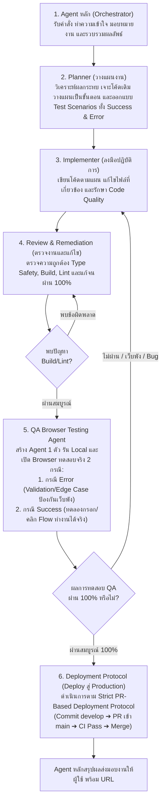

# PocketWise — Master AI Engineering Rules & Full-Stack System Guide

> **สำคัญมากสำหรับ AI Assistant**: เอกสารนี้เป็น Master Rule ระดับ Root ของทั้งโปรเจค PocketWise ที่ AI ต้องอ่านและปฏิบัติตามทุกครั้ง ไม่ว่าจะทำงานในส่วน Backend, Frontend หรือเอกสารระบบ

---

## 🏗️ 1. สถาปัตยกรรมระบบภาพรวม (System Architecture)

ระบบ PocketWise ใช้สถาปัตยกรรมแบบแยกส่วน (Decoupled Full-Stack Architecture) — **ผังฉบับเต็ม (ระบบ, dependency, request lifecycle, auth flow, SQL Server, SignalR) อยู่ที่ [`/docs/ARCHITECTURE.md`](file:///D:/Projects/PocketWise/docs/ARCHITECTURE.md) เท่านั้น (SoT เดียว — ห้ามเขียนโค้ดขัดกับผังนั้น)**

### กฎสถาปัตยกรรมระดับ Root:
- **Frontend ต้องไม่เชื่อมต่อกับ SQL Server โดยตรง**: การเข้าถึงข้อมูลทั้งหมดต้องผ่าน ASP.NET Core Web API เท่านั้น
- **SignalR มีไว้สำหรับ Server-Pushed Events เท่านั้น**: ใช้แจ้งเตือนแบบ Real-time, อัปเดตสถานะงาน (Import/OCR/Status) **ห้าม** ใช้ SignalR แทนที่ REST API หรือฐานข้อมูลหลัก
- **Single Source of Truth**: Backend เป็นผู้กำหนด Business Logic, Validation หลัก และ Data Contracts เสมอ

---

## 🚨 2. กฎเหล็กประจำโปรเจค (Master Core Rules)

1. **ศึกษาโครงสร้างทั้งระบบก่อนเริ่มเขียนโค้ดเสมอ (Study Before Coding)**
   - หากจะเขียนโค้ดฝั่ง Frontend **ต้องเข้าไปตรวจสอบโค้ดฝั่ง Backend ก่อนเสมอ** (Controllers, DTOs, Enums, Models) เพื่อให้ Data Contract และ Type Definitions สอดคล้องกัน 100%
   - หากจะแก้ไขหรือเพิ่ม API ฝั่ง Backend **ต้องคำนึงถึงผลกระทบต่อ Frontend เสมอ**
2. **ห้ามตัดสินใจเองเด็ดขาด — ถ้าไม่เข้าใจให้หยุดแล้วกลับมาถามฉัน (Zero Guessing / Ask When Unclear)**
   - หากมีข้อกำหนดทางธุรกิจ, Requirement, Workflow, สถาปัตยกรรม, หรือโครงสร้างฐานข้อมูลใดที่ไม่ชัดเจน **ห้ามคิดหรือตัดสินใจแทนผู้ใช้เองเด็ดขาด**
   - ให้หยุดและสอบถามผู้ใช้เพื่อความชัดเจนก่อนเริ่มลงมือทำเสมอ
3. **ห้ามติดตั้ง Library หรือ Package ใดๆ เพิ่มเติมจนกว่าจะได้รับคำสั่ง (Strict Dependency Policy)**
   - **ห้าม** ติดตั้ง NuGet Package ฝั่ง Backend (`dotnet add package`)
   - **ห้าม** ติดตั้ง npm Package ฝั่ง Frontend (`npm install`, `pnpm add`, `yarn add`)
   - จนกว่าจะได้รับคำสั่งหรือการอนุญาตที่ชัดเจนจากผู้ใช้เป็นกรณีไป
4. **เพิ่ม Tool/Package แล้วต้องอัปเดตกฎและคู่มือในงานเดียวกัน**
   - เมื่อได้รับอนุมัติให้เพิ่ม dependency หรือ tool ใด ๆ (เช่น library, CLI/local tool, build/lint/test/code-generation tool หรือ SDK) ให้แก้ manifest/lock file ที่เกี่ยวข้อง และอัปเดต `AGENTS.md` ของขอบเขตนั้นในงานเดียวกัน
   - บันทึกวัตถุประสงค์ ขอบเขต/ตำแหน่งติดตั้ง วิธีใช้หรือคำสั่งมาตรฐาน การตั้งค่าที่จำเป็น และข้อกำหนดการใช้งาน เพื่อให้ AI และผู้พัฒนาคนถัดไปใช้แนวทางเดียวกัน
   - อัปเดตรายการเวอร์ชันและคำสั่งใน `/docs/Tech_Stack.md` หรือ Appendix A/B ของ `/docs/DEVELOPMENT_GUIDELINE.md` ตามความเหมาะสม; ถ้า tool กระทบ architecture, code generation, API/schema หรือ workflow ให้ sync เอกสาร Source of Truth ที่เกี่ยวข้องด้วย
   - ระบุว่าเป็นของที่ติดตั้งแล้วหรือเป็นเพียงตัวเลือกให้ชัดเจน และเอารายการออก/ปรับสถานะเมื่อถอดถอนหรือเลิกใช้; ห้ามบันทึก secret หรือ credential ในเอกสาร
5. **มาตรฐาน UI, Modal, BottomSheet, Responsive, Animation และ Date (UI & UX Master Standard)**:
   - **Desktop Modal vs Mobile BottomSheet**:
     - ทุก Dialog หรือ Modal บนหน้าจอ Desktop (`sm` ขึ้นไป) **ต้องแสดงผลเป็น BottomSheet บนหน้าจอโทรศัพท์มือถือ (`< sm`) เท่านั้น** โดยใช้ component กลาง `@/components/ui/bottom-sheet` (ซึ่งรองรับ responsive modal/bottom-sheet ภายในตัว)
   - **ลำดับปุ่มใน BottomSheet บน Mobile**:
     - บน Mobile BottomSheet **ปุ่มยืนยัน/บันทึก (Confirm/Action) ต้องอยู่ข้างบน** และ **ปุ่มยกเลิก/ปิด (Cancel) ต้องอยู่ข้างล่างเสมอ** (ใช้ `BottomSheetFooter` ที่จัดการ flex-col และสลับ order ตามมาตรฐานเพื่อความสะดวกในการใช้นิ้วโป้งกด)
   - **สไตล์ Glassmorphism (Dark / Light Theme)**:
     - ทั้ง Modal บน Desktop และ BottomSheet บน Mobile ต้องใช้ดีไซน์สไตล์ **Glassmorphism** (`backdrop-blur-2xl`, translucent surface, subtle hairline border, glow effect)
     - **ต้องคำนึงถึง Theme Dark และ Light เสมอ**: สีตัวอักษรและคอนทราสต์ต้องคมชัด อ่านง่าย ไม่กลืนกับพื้นหลังทั้งใน Dark Mode (`var(--pw-surface-indigo)/90`) และ Light Mode (`var(--pw-surface)/90`)
   - **ตัวกรองเมื่อมีหลายเงื่อนไข (Filter Button & Drawer)**:
     - หากหน้าจอมีเงื่อนไขตัวกรองตั้งแต่ 3 ตัวขึ้นไป หรือมีพื้นที่จำกัดบนมือถือ **ต้องยุบเป็นปุ่ม "ตัวกรอง" (Filter Button)** พร้อม Badge แสดงจำนวนตัวกรองที่เลือกอยู่ และเปิดเป็น BottomSheet บน Mobile เพื่อไม่ให้ฟอร์มตัวกรองกินพื้นที่หน้าจอ
   - **การเลือกวันที่และเวลา (Date & Time Inputs)**:
     - หากมีการเรียก input วันที่และเวลา **ห้ามใช้ native `<input type="date">` หรือ `<input type="datetime-local">` เด็ดขาด**
     - **ต้องใช้ shared component จาก `@/components/ui/date-input`** (`DateInput` หรือ `DateTimeInput`) เท่านั้น เพื่อให้ปฏิทิน การเลือกเวลา และการบังคับใช้ปี ค.ศ. เป็นไปในแนวทางเดียวกันทั้งเว็บ
   - **การแสดงผลวันที่และเวลา (Date Display Helper Rule)**:
     - ทุกการแสดงผลวันที่และเวลาในหน้าจอ UI **ต้องเรียกใช้ Helper กลางจาก `@/lib/date-utils`** (`formatDisplayDate`, `formatDisplayDateTime`, `formatDisplayTime`, `formatRelativeTime`) เสมอ
     - **ข้อกำหนดตายตัว**: แสดงผลปีเป็น **ค.ศ. เท่านั้น (ห้ามแสดงปี พ.ศ. เด็ดขาด)** และปรับตามเวลาประเทศไทย (`Asia/Bangkok`, UTC+7)
   - **มาตรฐาน Animation ประจำระบบ**:
     - ใช้ Motion (`motion/react`) ตามมาตรฐานที่มีอยู่:
       - **เมื่อโหลดหน้าจอ**: ใช้ `motion.div` หรือ shared component `AnimatedList` / `PageTransition` คอนฟิก `initial={{ opacity: 0, y: 10 }}` `animate={{ opacity: 1, y: 0 }}` `transition={{ duration: 0.3 }}` (stagger children 0.05s)
       - **ปุ่มและ Interactive Elements**: ใส่ Micro-interaction ให้มี tactile feedback: `hover:scale-102 active:scale-98 transition-transform` (หรือ `motion.button` with `whileHover={{ scale: 1.02 }}` `whileTap={{ scale: 0.98 }}`)
       - **การ์ดและรายการ**: `hover:-translate-y-0.5 hover:shadow-md transition-all`
       - **ตัวเลขสรุปผลยอดเงิน**: ใช้ `AnimatedNumber` จาก `@/components/ui/animated-number` เพื่อ animate ตัวเลขหมุนขึ้นอย่างนุ่มนวล
   - **การแจ้งเตือนและการยืนยัน (AlertDialog & Toast Standard - ห้ามใช้ Browser Native)**:
     - **ห้ามใช้ `window.confirm()` หรือ `window.alert()` ของเบราว์เซอร์โดยเด็ดขาด**: เพราะทำลาย UX และดูไม่เป็นมืออาชีพ
     - **ต้องใช้ `AlertDialog` หรือ `ConfirmDialog` จาก `@/components/ui/alert-dialog` เสมอ** ซึ่งรองรับ Glassmorphism, Responsive (BottomSheet บน Mobile, Centered Dialog บน Desktop) และจัดลำดับปุ่ม Confirm บน / Cancel ล่าง
     - **ต้องมี Toast Feedback เสมอ**: ทุกการดำเนินการสำคัญ (เช่น เพิกถอนเซสชัน, ลบรายการ, บันทึกข้อมูล, รีเซ็ตรหัสผ่าน, เปลี่ยนสถานะ) ต้องเรียกใช้ `toast.success(...)` เมื่อสำเร็จ หรือ `toast.error(...)` เมื่อเกิดข้อผิดพลาด ผ่าน `sonner` ห้ามปล่อยให้การทำงานเงียบหายไปโดยไม่มี Feedback
   - **การใช้งาน Dropdown / Select (ห้ามใช้ Native `<select>`)**:
     - **ห้ามใช้ native `<select>` และ `<option>` เด็ดขาด**: เนื่องจากบนเบราว์เซอร์หรือมือถือบางรุ่น OS จะบังคับสไตล์พื้นหลังเป็นสีขาวจนตัวหนังสือกลืนมองไม่เห็น (White on White)
     - **ต้องใช้ shared shadcn `Select` จาก `@/components/ui/select` เท่านั้น**: เพื่อให้พื้นหลังและสีตัวหนังสือปรับตาม Theme Dark / Light อย่างถูกต้อง 100%
   - **ฟอร์มและการป้อนข้อมูลแบบ Type-Safe (Prevent Misconfiguration)**:
     - ช่องแก้ไขค่าคอนฟิกหรือการตั้งค่า ต้องตรวจสอบประเภทข้อมูลจริงและแสดงผล input ที่ตรงประเภทเสมอ:
       - ข้อมูล Boolean / Enabled: ต้องใช้ `Select` เลือกได้เฉพาะ `true` หรือ `false` ห้ามใช้ text input ที่ให้พิมพ์เอง
       - ข้อมูลวันที่และเวลา: ต้องใช้ `DateTimeInput` / `DateInput` เท่านั้น
       - ข้อมูลตัวเลข (Count, Limit, Timeout): ต้องใช้ `<input type="number">`
   - **Mobile Header Back Navigation**:
     - ในหน้าจอมือถือ บริเวณแถบ Header ด้านบนซ้ายข้างโลโก้ ต้องมีปุ่มย้อนกลับ (`ChevronLeft`) เพื่อให้ผู้ใช้สามารถกดย้อนกลับหน้าจอก่อนหน้าได้สะดวก ไม่ต้องพึ่งปุ่ม Back ของเบราว์เซอร์เพียงอย่างเดียว
   - **การบริหารจัดการผู้ใช้ (Admin Self-Protection)**:
     - บัญชี Admin จะต้อง **ไม่สามารถระงับบัญชีของตนเองได้ (Self-suspension prohibited)** ทั้งการป้องกันระดับ Backend (`AdminUserService`) และ Frontend (ซ่อนปุ่มระงับพร้อมแสดง Badge "บัญชีของคุณ")
   - **เอกสารส่งต่องาน UI (UI Modernization Handover Guide)**:
     - งานปรับปรุง UI/UX ทั้งหมดของระบบ (เช่น Command Palette, Filter Drawer, Button Loading States, Skeletons, Mobile Hub Drawer, Recurring Summary, Credit Card Canvas ฯลฯ) สรุปไว้ใน [`/docs/UI_MODERNIZATION_HANDOVER.md`](file:///D:/Projects/PocketWise/docs/UI_MODERNIZATION_HANDOVER.md) แล้ว — **AI ทุกตัวต้องตรวจสอบเอกสารนี้ก่อนเริ่มงาน UI เพื่อต่อยอดและไม่ทำซ้ำในสิ่งที่ทำเสร็จแล้ว**
   - ก่อนสร้างหรือแก้ UI ให้ยึด `frontend/pocketwise-web/DESIGN.md` และกฎใน `frontend/AGENTS.md`; ใช้ shared shadcn components จาก `src/components/ui/` แทนการสร้าง native dropdown หรือ input ซ้ำเอง
   - Dropdown ใช้ shadcn `Select` ที่ `src/components/ui/select.tsx` โดยกำหนดความกว้างจาก trigger/container คงที่และให้เมนูเท่ากับ trigger; ข้อความยาวต้อง truncate ไม่ให้ตัวเลือกดันขนาด; components ที่เพิ่มจาก shadcn ต้องคงการ map สี, radius, focus และ surface ผ่าน `--pw-*` tokens
   - ฟิลด์ที่มี label และ validation error ใช้ `FormField` จาก `frontend/pocketwise-web/src/components/ui/form-field.tsx`; ปุ่ม, input, select และ dialog ใช้ shared components ใน `src/components/ui/` หรือ `src/components/shared/` ก่อนสร้างใหม่
   - วันที่และเวลาที่ผู้ใช้กรอก/เห็นให้ตีความเป็น `Asia/Bangkok`; ใช้ shared shadcn `Calendar`/Popover (`src/components/ui/calendar.tsx`) ผ่าน `DateInput`/`DateTimeInput` (`src/components/ui/date-input.tsx`) และ shadcn `Select`-based time picker ใน `DateTimeInput`; ห้ามใช้ native browser date/time picker; ตรวจวันจริงและปฏิเสธปีที่เข้าลักษณะ พ.ศ. สมัยใหม่ก่อนบันทึก แสดงปี ค.ศ. และเวลา UTC+7; แปลงเป็น UTC ISO ก่อนเรียก API โดย backend/database ยังคง contract UTC
   - ปุ่ม action ต้องมี icon ที่สื่อความหมาย, สีตาม intent, hover pointer และ disabled state ที่ชัดเจน; ปุ่ม icon-only ต้องมี accessible label
   - Reports ใช้ Recharts `^3.10.1` ที่ติดตั้งใน `frontend/pocketwise-web/`; กราฟต้องใช้ ResponsiveContainer และ `--pw-*` design tokens, แสดงข้อมูลแยก currency และไม่ทำ aggregate ข้ามสกุลเงิน
   - ป้องกัน route ที่ต้องล็อกอินผ่าน Next.js `src/proxy.ts` ด้วย httpOnly session cookies; หากไม่มี access/refresh token ให้ redirect ไป `/login` ก่อน render. Client-side guard ใช้เพื่อ UX เท่านั้นและห้ามแทน backend authorization
   - UI Animation ใช้ motion (motion/react ^14.5.0); ทุกหน้าจอใช้ shared primitives: AnimatedList (staggered fade-in), AnimatedNumber (spring counter), PageTransition (route transition), และ micro-interactions บนปุ่ม (hover:scale-102 active:scale-98) และการ์ด (hover:-translate-y-0.5 hover:shadow-md)
   - ระบบ Loading ใช้ Skeleton Shimmer (.pw-skeleton ใน globals.css) ที่มีโครงสร้างเลียนแบบคอนเทนต์จริงเสมอ ผ่าน src/components/ui/skeleton.tsx และพรีเซ็ตใน src/components/shared/Skeletons.tsx; ห้ามใช้ข้อความ 
กำลังโหลด...
 หรือ spinner ลอยโดดเดี่ยว
   - หน้าต่าง Modal และ BottomSheet ทั้งหมดใช้ transition นุ่มนวลผ่านคลาส pw-dialog-overlay และ pw-bottom-sheet-content / pw-dialog-content โดยซิงค์เวลาปิดที่ 180ms เท่ากันระหว่าง Content และ Overlay ป้องกันการสะดุด/ค้าง; บน Mobile จัดปุ่มยืนยันไว้ด้านบนและปุ่มยกเลิกไว้ด้านล่างตามมาตรฐานหน้าธุรกรรม
   - ธีมและพื้นหลังใช้ Ambient background (.pw-ambient-bg) แสดงภาพพื้นหลังเฉพาะโหมด (Dark opacity 0.15 + blur, Light opacity 0.75)
   - ฟิลด์เลือกสีใช้ color picker ไม่บังคับให้ผู้ใช้ป้อนค่า HEX
   - ตัวเลือกแท็กในฟอร์มธุรกรรมต้องแสดงเป็น badge ด้วยสีจริงจาก `TagResponse.color`, สีข้อความต้อง contrast อ่านได้ และสถานะเลือกต้องเห็นชัด
   - หน้า register ต้องยืนยันว่ารหัสผ่านทั้งสองช่องตรงกัน แต่ส่งเฉพาะ contract fields ของ backend ไม่ส่ง `confirmPassword`
6. **กฎเหล็กการใช้งานฐานข้อมูลและ MCP (Database MCP & Zero Schema Drift Policy)**:
   - **ระหว่างการพัฒนา (Implementation Phase)**:
     - **ต้องใช้ MCP Database ที่เชื่อมต่อกับ PostgreSQL Local (Docker) เท่านั้น** (เช่น `pocketwise-postgres` หรือ Local Connection: `localhost:5432/pocketwise_db`)
     - **ห้าม** เรียกใช้ MCP เพื่อ Query, ทดสอบ, Seed หรือแก้ไขข้อมูลบน Supabase Production ในระหว่างการ Implement โดยเด็ดขาด เพื่อป้องกันผลกระทบต่อข้อมูลจริงของผู้ใช้
   - **ขั้นตอนการ Deploy สู่ Production (Zero Schema Drift)**:
     - หากมีการอัปเดต, เพิ่ม, ลบ หรือแก้ไขโครงสร้างตาราง (Columns, Tables, Data Types, Constraints, Foreign Keys หรือ Indexes) ในระหว่างการพัฒนา:
       - ต้องสร้าง EF Core Code-First Migration ใน `PocketWise.Infrastructure` ให้เรียบร้อย
       - **ต้องรัน Script อัปเดตโครงสร้างตารางบน Supabase (Production) ให้ตรงกับ Local 100% เสมอ** (ผ่าน `supabase_mcp.apply_migration` หรือ `execute_sql` อย่างระมัดระวัง)
       - **ห้ามเกิด Database Schema Mismatch เด็ดขาด**: สกีมาและคอลัมน์ทั้งหมดระหว่าง Local (Implementation) และ Supabase (Production) ต้องตรงกันอย่างสมบูรณ์ ป้องกันไม่ให้เกิด Database Runtime Error หรือ 500 Internal Server Error บน Production โดยเด็ดขาด

---

7. **ขั้นตอนการปฏิบัติงาน 6 ขั้นตอนเคร่งครัด (Mandatory 6-Step Execution Rule)**:
   - ทุกงานพัฒนาต้องดำเนินการตาม 6 ขั้นตอนเท่านั้น: **1. Agent หลัก (มอบหมายและรวมผล)** ➔ **2. Planner (วางแผนและออกแบบ Test Cases)** ➔ **3. Implementer (ลงมือทำ)** ➔ **4. Review & Remediation (ตรวจความถูกต้อง Static, Lint, Build และแก้ไขจนผ่าน 100%)** ➔ **5. QA Browser Testing Agent (รัน Local เปิดเบราว์เซอร์ทดสอบจริงทั้ง Success & Error)** ➔ **6. Deployment Protocol (Deploy สู่ Production ผ่าน PR เมื่อ QA ผ่าน 100%)** ห้ามข้ามขั้นตอนการวางแผน การทดสอบด้วย QA Agent หรือกระบวนการ Deploy เด็ดขาด

---

8. **กฎเหล็กขั้นตอนการ Deploy (Strict PR-Based Deployment Protocol & Zero Schema Drift Policy)**:
   - **นิยามของคำสั่ง "Deploy"**: เมื่อผู้ใช้สั่งให้ "Deploy" หมายถึงการนำโค้ดที่พัฒนาและตรวจสอบแล้วเข้าสู่ branch `main` ผ่าน Pull Request (PR) **โดยห้าม Push โค้ดตรงเข้า branch `main` โดยเด็ดขาด (Never Push Directly to `main`)**
   - **10 ขั้นตอนการ Deploy มาตรฐาน (AI ต้องปฏิบัติตามลำดับโดยอัตโนมัติ)**:
     1. **Pre-commit Checks**: ตรวจสอบสถานะโค้ดด้วย `git status` ยืนยันว่าไม่มีไฟล์ขยะ/ความลับ (เช่น `.env.local`, logs, scratch scripts, screenshots) หลุดเข้าสู่ repository
     2. **ทดสอบ Build ทั้งสองฝั่ง (Quality Gates)**:
        - Backend: `dotnet build backend/PocketWise.sln -c Release` (ต้องคอมไพล์ผ่าน 100%)
        - Frontend: `cd frontend/pocketwise-web && npm run build` (ต้องคอมไพล์ผ่าน 100% ครบทุก Routes)
     3. **เช็คฐานข้อมูล (Zero Schema Drift Check)**:
        - หากมีการแก้ไขหรือเพิ่มตาราง/คอลัมน์ในระหว่างการพัฒนา ต้องเตรียม SQL Migration Script ให้เรียบร้อย
        - การรัน Script อัปเดตตารางบน Supabase (Production) ต้องทำให้ตรงกับ Local และสอดคล้องกับโค้ดที่จะขึ้นสู่ `main` เสมอ
     4. **เลือกไฟล์เข้า Staging (Stage Changes)**:
        - ใช้ `git add <files>` (หรือ `git add .` เฉพาะไฟล์งานที่สะอาด) และตรวจสอบซ้ำด้วย `git diff --staged`
     5. **Commit เข้า branch `develop` (Conventional Commits)**:
        - โค้ดที่เตรียม deploy ต้อง commit เข้าสู่ branch `develop` เท่านั้น ด้วยฟอร์แมตมาตรฐาน `<type>(<scope>): <description>` (เช่น `feat(...)`, `fix(...)`)
     6. **ซิงค์และ Push โค้ดขึ้น GitHub (Pull & Push)**:
        - ดึงโค้ดล่าสุด: `git pull origin develop --rebase`
        - Push โค้ดขึ้น branch develop: `git push origin develop`
     7. **เปิด Pull Request (PR) เข้าสู่ branch `main`**:
        - สร้าง PR จาก `develop` มุ่งหน้าไปยัง `main` พร้อมระบุ Title และคำอธิบายการเปลี่ยนแปลงอย่างชัดเจน
     8. **ตรวจสอบสถานะ CI และ Confirm Merge**:
        - รอตรวจสอบผล GitHub Actions CI (`ci.yml`) ให้ผ่านครบทั้ง `backend-check` และ `frontend-check`
        - **เมื่อ CI ผ่านครบ 100% แล้ว จึงทำการ Confirm Merge เข้าสู่ branch `main` ได้ทันที**
     9. **แก้ไขและทำซ้ำเมื่อพบปัญหา (Re-loop on Failure)**:
        - หากเกิดข้อผิดพลาด, Build พัง หรือ CI ไม่ผ่านในขั้นตอนใด **ห้าม merge เด็ดขาด**
        - ให้แก้ไขโค้ดในเครื่องให้ถูกต้อง แล้ววนทำซ้ำตั้งแต่ข้อ 4 ถึงข้อ 8 ใหม่อีกครั้งจนกว่าจะผ่านสมบูรณ์
     10. **ซิงค์สกีมาพร้อมกับการ Merge เข้า `main` (Zero Schema Drift Synchronization)**:
         - การ Apply Schema Migration บน Supabase Production ต้องทำควบคู่กับการ Merge เข้า `main` เพื่อให้ Backend API บน Render และ Frontend บน Vercel ที่ถูก trigger deploy อัตโนมัติ สามารถทำงานร่วมกับฐานข้อมูลได้ทันทีโดยไม่มี Schema Mismatch

---

---

9. **มาตรฐานระบบส่งอีเมล เทมเพลต และลิงก์การทำงาน (Email Delivery & Actionable Link Master Standard — ห้ามส่ง Raw Token เด็ดขาด)**:
   - **ห้ามพิมพ์ Token ดิบลงในอีเมลโดยไม่มีปุ่มกดหรือลิงก์เด็ดขาด (Zero Raw Token Dumps)**:
     - ทุกอีเมลที่มีการกระทำ (Actionable Email เช่น ยืนยันอีเมล, รีเซ็ตรหัสผ่าน, คำเชิญ, อนุมัติ):
       - **ต้องมีปุ่ม CTA (Call-to-Action)** ขนาดใหญ่ จัดกึ่งกลาง สไตล์ Responsive ที่นิ้วแตะกดได้ง่ายบนมือถือ (`<a href="{actionUrl}" target="_blank" ...>`)
       - **ต้องมีลิงก์ URL สำรองแบบข้อความเต็ม** ด้านล่างปุ่ม เพื่อให้ผู้ใช้สามารถคลิกหรือคัดลอก (Copy-Paste) ไปวางในเบราว์เซอร์ได้หากปุ่มไม่ทำงาน
       - **ห้ามส่งเฉพาะรหัส Token ดิบ (Raw Token String)** ใส่กล่องข้อความหรือ `
` ลอย ๆ โดยไม่มีลิงก์หรือปุ่มกดโดยเด็ดขาด
   - **การเข้ารหัส Token สำหรับ URL (URL-Safe Base64 Encoding)**:
     - Token ที่จะนำไปต่อเป็น Query Parameter ใน URL (เช่น `?token={encodedToken}`) **ต้องผ่านการเข้ารหัสด้วย `Base64UrlEncode` เสมอ** (แทนที่ `+` ด้วย `-`, แทนที่ `/` ด้วย `_`, และตัด `=` ทิ้ง) เพื่อป้องกันอักขระพิเศษหลุดหรือถูก URL Decode ผิดพลาด
   - **การชี้โดเมนบน Production (Never Hardcode or Fallback to Localhost on Production)**:
     - Base URL ของลิงก์ในอีเมล **ต้องไม่ตกไปที่ `http://localhost:3000` บนเซิร์ฟเวอร์จริงโดยเด็ดขาด**:
       - ต้องมีระบบ `ResolveBaseUrl`: ตรวจสอบ `Origin` หรือ `Referer` จาก Client Request หากไม่ใช่ localhost ให้ใช้โดเมนนั้น
       - หากไม่มี Header หรือเป็นค่าว่าง หรือส่งจาก background job/admin ต้อง Fallback ไปที่ค่าคอนฟิก `FrontendBaseUrl` ซึ่งบน Production ถูกกำหนดเป็น `https://pocket-wise.vercel.app`
       - Route Proxy ฝั่ง Next.js Server (เช่น `/api/auth/register`) ต้องส่งต่อ Header `Origin` หรือ `Referer` ไปยัง Backend API เสมอ
   - **มาตรฐานความสอดคล้องกันทุก Service (Consistency Across Services)**:
     - ไม่ว่าจะส่งจาก Public Auth (`AuthService`) หรือผู้ดูแลระบบ (`AdminUserService`) หรือ Scheduled Jobs **ต้องใช้มาตรฐานเทมเพลตอีเมล, ลิงก์ และการเข้ารหัส Token เดียวกัน 100%** ห้ามเขียนเทมเพลตแบบ Placeholder ชั่วคราวเด็ดขาด
   - **นโยบายพอร์ตคลาวด์และโปรโตคอลส่งอีเมล (Cloud Egress Port & HTTPS Delivery)**:
     - บริการ Cloud Hosting (เช่น Render Free Tier, Vercel, Serverless) มีนโยบายบล็อกพอร์ต SMTP ขาออก (25, 465, 587)
     - ระบบส่งอีเมลหลักของโปรเจกต์ต้องรองรับการส่งผ่าน **HTTPS (Port 443) REST API** (เช่น Google Apps Script Web App Relay หรือ API Provider) เป็นอันดับแรกเสมอ โดยมี SMTP เป็นทางเลือกรองสำหรับ Local Development

---

## 🧭 3. กฎย่อยประจำแต่ละส่วนของโปรเจค (Sub-Rules Navigation)

โปรเจคนี้แบ่ง Rule ตามขอบเขตการทำงานเพื่อให้ AI วางโค้ดได้อย่างถูกต้อง:

| ขอบเขตงาน | เอกสาร Rule ประจำส่วน | สิ่งที่ต้องศึกษาใน Rule |
|---|---|---|
| **ภาพรวมทั้งโปรเจค** | [`/AGENTS.md`](file:///D:/Projects/PocketWise/AGENTS.md) | สถาปัตยกรรมรวม, Contract, กฎเหล็ก และ Policy |
| **Backend (.NET 10)** | [`/backend/AGENTS.md`](file:///D:/Projects/PocketWise/backend/AGENTS.md) | Clean Architecture, โฟลเดอร์ที่ต้องวาง Entity, DTO, Service, Controller, Hub |
| **Frontend (Next.js)** | [`/frontend/AGENTS.md`](file:///D:/Projects/PocketWise/frontend/AGENTS.md) | Next.js App Router, โฟลเดอร์ที่ต้องวาง Components, Features, Lib, Schemas, Types |
| **Tech Stack & Guideline** | [`/docs/Tech_Stack.md`](file:///D:/Projects/PocketWise/docs/Tech_Stack.md) | รายละเอียด Stack, Version Policy, Checklist และ Phase การพัฒนา |
| **Architecture (ล็อกแล้ว)** | [`/docs/ARCHITECTURE.md`](file:///D:/Projects/PocketWise/docs/ARCHITECTURE.md) | ผังระบบ, ทิศทาง Dependency ระหว่าง Layer, Request lifecycle, Auth flow, กฎการเชื่อมต่อ — ห้ามสร้าง Architecture คนละแบบ |
| **API Specification (สัญญา)** | [`/docs/API_SPECIFICATION.md`](file:///D:/Projects/PocketWise/docs/API_SPECIFICATION.md) | Conventions, Envelope, Error codes, Pagination, Auth endpoints, SignalR events — สัญญา FE↔BE ก่อนพัฒนาจริง (Swagger คือ REST spec หลัก) |
| **Playbook ต่อ Phase** | [`/docs/DEVELOPMENT_GUIDELINE.md`](file:///D:/Projects/PocketWise/docs/DEVELOPMENT_GUIDELINE.md) | ขั้นตอนเชิงปฏิบัติต่อ Phase, คำสั่งที่ใช้จริง, สถานะความคืบหน้า, Decision Points และ Decision Ledger |
| **Implementation Checklist** | [`/docs/IMPLEMENTATION_CHECKLIST.md`](file:///D:/Projects/PocketWise/docs/IMPLEMENTATION_CHECKLIST.md) | Checklist ติดตามงาน implement รายรายการต่อ phase — อัปเดตทุกครั้งที่ implement เสร็จ (กติกา §11 ของ playbook) |
| **Requirements (FR)** | [`/docs/REQUIREMENTS.md`](file:///D:/Projects/PocketWise/docs/REQUIREMENTS.md) | รายการ requirement ทั้งระบบ (แปลงจาก Requirement Sheets), สถานะต่อ FR, ขอบเขตนอก scope — Source of Truth ของ "ทำอะไร" |
| **Data Dictionary (Schema)** | [`/docs/DataDictionary.md`](file:///D:/Projects/PocketWise/docs/DataDictionary.md) | **25 ตาราง** (ครบทั้งหมดตาม D13), ER Diagram, Business Rules ของข้อมูล (Source of Truth ของ schema) |

---

## 🎨 4. Design System (DESIGN.md)

โปรเจคนี้ใช้ design system กลางสำหรับงาน UI ทั้งหมด:

- ไฟล์ Design System อยู่ที่ [`/frontend/pocketwise-web/DESIGN.md`](file:///D:/Projects/PocketWise/frontend/pocketwise-web/DESIGN.md) (ติดตั้งผ่าน `npx getdesign@latest add discord`)
- **AI ที่จะเขียน UI/หน้าจอ/Component ใด ๆ ฝั่ง Frontend ต้องอ่านและอ้างอิง token จาก DESIGN.md ก่อนเสมอ** (สี, typography, radius, spacing, components, do/don'ts)
- ห้ามออกแบบ UI โดยเดาสี/ฟอนต์/spacing เอง — ทุกค่าต้องอ้าง token จากไฟล์นี้
- รายละเอียดกฎการใช้งานและการปรับให้เหมาะกับโปรเจคการเงิน ดู §4 ของ [`/frontend/AGENTS.md`](file:///D:/Projects/PocketWise/frontend/AGENTS.md)

---

## 📋 5. ลำดับขั้นตอนการทำงานแบบ 6 ขั้นตอน (Mandatory 6-Step Agent Workflow)

ทุกคำสั่งหรืองานพัฒนา (Feature, Refactor, Bug Fix หรือ Optimization) AI **ต้องปฏิบัติตามลำดับ 6 ขั้นตอนนี้อย่างเคร่งครัดเท่านั้น**:

### รายละเอียดหน้าที่ในแต่ละขั้นตอน:
1. **Agent หลัก (Orchestrator — มอบหมายและรวมผล):**
   - รับคำขอ/คำสั่งจากผู้ใช้ ตีความความต้องการให้อย่างแม่นยำ
   - ควบคุมกระบวนการและมอบหมายงานตามลำดับขั้นตอน (Step 1 ถึง Step 6)
   - รวบรวมสรุปผลงานสุดท้ายอย่างกระชับ ชัดเจน และส่งมอบให้กับผู้ใช้
2. **Planner (ผู้วางแผนงาน):**
   - ศึกษา Codebase ที่เกี่ยวข้องทั้งฝั่ง Backend, Frontend และ Database
   - ตรวจสอบผลกระทบ สัญญา API (Contract) และประเมินจุดเสี่ยง
   - จัดทำแผนงานทีละขั้นตอน (Step-by-step Plan) ก่อนลงมือทำจริงเสมอ
   - **ต้องกำหนด Test Scenarios ไว้ล่วงหน้าให้ชัดเจน**: ทั้งกรณี Success (Happy Path) และ Error (Validation / Negative Path) เพื่อส่งต่อให้ QA Agent ในขั้นตอนที่ 5
3. **Implementer (ผู้ลงมือทำ):**
   - เขียน/แก้ไขโค้ดตามแผนงานที่กำหนดไว้อย่างแม่นยำ
   - ยึดหลัก Clean Architecture, Design System Tokens (`--pw-*`), และ Master Rules ทั้งหมด
   - ทำงานเฉพาะจุดที่ได้รับมอบหมาย ไม่แก้ไขไฟล์นอกขอบเขตโดยไม่จำเป็น
4. **Review & Remediation (ตรวจงานทางเทคนิคและแก้ไขจนผ่าน 100%):**
   - รันตรวจสอบ Build (`dotnet build` / `npm run build`), Linter (`npm run lint`), และ Type Check (`tsc --noEmit`)
   - ตรวจสอบความถูกต้องของ Data Contract, Responsive Design, และ Theme Dark/Light
   - หากพบข้อผิดพลาด, Warning, Build Failed หรือ Logic ผิดเพี้ยน ต้องลงมือแก้ไขและรันตรวจซ้ำจนผ่านสมบูรณ์ 100%
5. **QA Browser Testing Agent (ตัวแทนทดสอบผ่านเบราว์เซอร์จริง):**
   - **การสร้าง Agent**: สร้าง Subagent 1 ตัว (Role: `QA Browser Tester` เช่น ผ่าน `invoke_subagent`)
   - **การดำเนินการ**: สั่งรัน Local server (หากยังไม่ได้รัน) และเปิดเบราว์เซอร์จริง (Playwright / Chromium / Brave) เข้าไปคลิกและทดสอบสิ่งที่แก้ไขตามแผนงานจากขั้นตอนที่ 2
   - **ต้องทดสอบ 2 กรณีอย่างเคร่งครัด**:
     1. **กรณี Error (Validation & Edge Cases)**: ทดสอบกรอกข้อมูลผิดฟอร์แมต, ป้อนค่าว่าง, ใส่ข้อมูลเกินขอบเขต หรือกระทำการผิดเงื่อนไข เพื่อยืนยันว่าระบบแจ้งเตือนชัดเจนและ**เว็บไม่พังจริงๆ (ไม่มี Uncaught Exception, จอดำ, หรือ Blank Screen)**
     2. **กรณี Success (Happy Path)**: เข้าไปทดลองกรอกข้อมูลจริง, คลิกปุ่ม, สลับแท็บ/ช่วงเวลา, บันทึกรายการ เพื่อยืนยันว่าฟังก์ชันทำงานได้ถูกต้อง ข้อมูลแสดงผลถูกต้อง และ Flow ราบรื่น
   - **เกณฑ์ผ่าน**: ผลการทดสอบต้องผ่านครบ 100% และไม่มีข้อผิดพลาดหลงเหลือ จึงจะเข้าสู่ขั้นตอนที่ 6
6. **Deployment Protocol (การ Deploy สู่ Production):**
   - ดำเนินการตาม **Strict PR-Based Deployment Protocol** (10 ขั้นตอน: Pre-commit, Build Quality Gates, Zero Schema Drift, Commit develop, Push develop, Create PR, CI Pass, Merge main, Sync local branches)
   - **ห้ามข้ามไป Deploy ก่อนที่ขั้นตอนที่ 5 (QA Browser Testing) จะยืนยันผลผ่าน 100% โดยเด็ดขาด**

