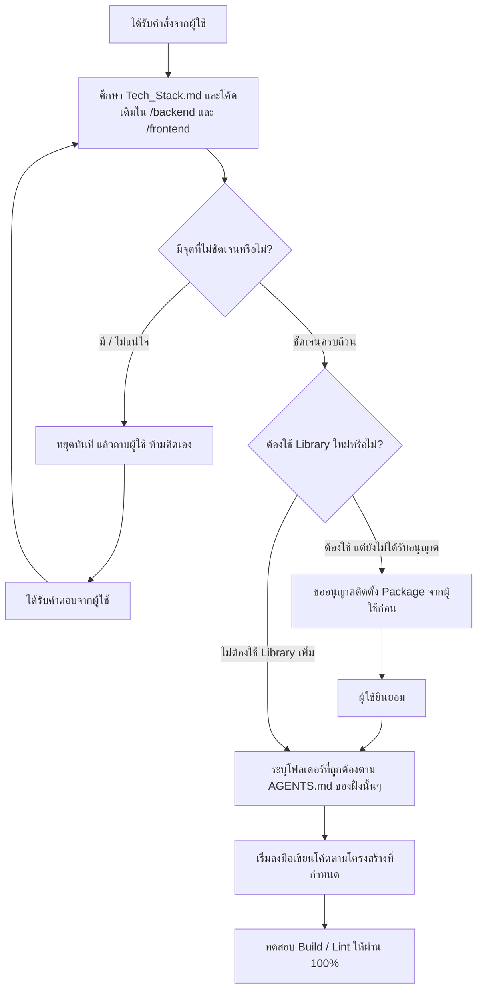

# PocketWise — Master AI Engineering Rules & Full-Stack System Guide

> **สำคัญมากสำหรับ AI Assistant**: เอกสารนี้เป็น Master Rule ระดับ Root ของทั้งโปรเจค PocketWise ที่ AI ต้องอ่านและปฏิบัติตามทุกครั้ง ไม่ว่าจะทำงานในส่วน Backend, Frontend หรือเอกสารระบบ

---

## 🏗️ 1. สถาปัตยกรรมระบบภาพรวม (System Architecture)

ระบบ PocketWise ใช้สถาปัตยกรรมแบบแยกส่วน (Decoupled Full-Stack Architecture) — **ผังฉบับเต็ม (ระบบ, dependency, request lifecycle, auth flow, SQL Server, SignalR) อยู่ที่ [`/docs/ARCHITECTURE.md`](file:///D:/Projects/PocketWise/docs/ARCHITECTURE.md) เท่านั้น (SoT เดียว — ห้ามเขียนโค้ดขัดกับผังนั้น)**

### กฎสถาปัตยกรรมระดับ Root:
- **Frontend ต้องไม่เชื่อมต่อกับ SQL Server โดยตรง**: การเข้าถึงข้อมูลทั้งหมดต้องผ่าน ASP.NET Core Web API เท่านั้น
- **SignalR มีไว้สำหรับ Server-Pushed Events เท่านั้น**: ใช้แจ้งเตือนแบบ Real-time, อัปเดตสถานะงาน (Import/OCR/Status) **ห้าม** ใช้ SignalR แทนที่ REST API หรือฐานข้อมูลหลัก
- **Single Source of Truth**: Backend เป็นผู้กำหนด Business Logic, Validation หลัก และ Data Contracts เสมอ

---

## 🚨 2. กฎเหล็กประจำโปรเจค (Master Core Rules)

1. **ศึกษาโครงสร้างทั้งระบบก่อนเริ่มเขียนโค้ดเสมอ (Study Before Coding)**
   - หากจะเขียนโค้ดฝั่ง Frontend **ต้องเข้าไปตรวจสอบโค้ดฝั่ง Backend ก่อนเสมอ** (Controllers, DTOs, Enums, Models) เพื่อให้ Data Contract และ Type Definitions สอดคล้องกัน 100%
   - หากจะแก้ไขหรือเพิ่ม API ฝั่ง Backend **ต้องคำนึงถึงผลกระทบต่อ Frontend เสมอ**
2. **ห้ามตัดสินใจเองเด็ดขาด — ถ้าไม่เข้าใจให้หยุดแล้วกลับมาถามฉัน (Zero Guessing / Ask When Unclear)**
   - หากมีข้อกำหนดทางธุรกิจ, Requirement, Workflow, สถาปัตยกรรม, หรือโครงสร้างฐานข้อมูลใดที่ไม่ชัดเจน **ห้ามคิดหรือตัดสินใจแทนผู้ใช้เองเด็ดขาด**
   - ให้หยุดและสอบถามผู้ใช้เพื่อความชัดเจนก่อนเริ่มลงมือทำเสมอ
3. **ห้ามติดตั้ง Library หรือ Package ใดๆ เพิ่มเติมจนกว่าจะได้รับคำสั่ง (Strict Dependency Policy)**
   - **ห้าม** ติดตั้ง NuGet Package ฝั่ง Backend (`dotnet add package`)
   - **ห้าม** ติดตั้ง npm Package ฝั่ง Frontend (`npm install`, `pnpm add`, `yarn add`)
   - จนกว่าจะได้รับคำสั่งหรือการอนุญาตที่ชัดเจนจากผู้ใช้เป็นกรณีไป
4. **เพิ่ม Tool/Package แล้วต้องอัปเดตกฎและคู่มือในงานเดียวกัน**
   - เมื่อได้รับอนุมัติให้เพิ่ม dependency หรือ tool ใด ๆ (เช่น library, CLI/local tool, build/lint/test/code-generation tool หรือ SDK) ให้แก้ manifest/lock file ที่เกี่ยวข้อง และอัปเดต `AGENTS.md` ของขอบเขตนั้นในงานเดียวกัน
   - บันทึกวัตถุประสงค์ ขอบเขต/ตำแหน่งติดตั้ง วิธีใช้หรือคำสั่งมาตรฐาน การตั้งค่าที่จำเป็น และข้อกำหนดการใช้งาน เพื่อให้ AI และผู้พัฒนาคนถัดไปใช้แนวทางเดียวกัน
   - อัปเดตรายการเวอร์ชันและคำสั่งใน `/docs/Tech_Stack.md` หรือ Appendix A/B ของ `/docs/DEVELOPMENT_GUIDELINE.md` ตามความเหมาะสม; ถ้า tool กระทบ architecture, code generation, API/schema หรือ workflow ให้ sync เอกสาร Source of Truth ที่เกี่ยวข้องด้วย
   - ระบุว่าเป็นของที่ติดตั้งแล้วหรือเป็นเพียงตัวเลือกให้ชัดเจน และเอารายการออก/ปรับสถานะเมื่อถอดถอนหรือเลิกใช้; ห้ามบันทึก secret หรือ credential ในเอกสาร
5. **มาตรฐาน UI ใช้ร่วมกันทั้งโปรเจกต์**
   - ก่อนสร้างหรือแก้ UI ให้ยึด `frontend/pocketwise-web/DESIGN.md` และกฎใน `frontend/AGENTS.md`; ใช้ shared shadcn components จาก `src/components/ui/` แทนการสร้าง native dropdown หรือ input ซ้ำเอง
   - Dropdown ใช้ shadcn `Select` ที่ `src/components/ui/select.tsx` โดยกำหนดความกว้างจาก trigger/container คงที่และให้เมนูเท่ากับ trigger; ข้อความยาวต้อง truncate ไม่ให้ตัวเลือกดันขนาด; components ที่เพิ่มจาก shadcn ต้องคงการ map สี, radius, focus และ surface ผ่าน `--pw-*` tokens
   - ฟิลด์ที่มี label และ validation error ใช้ `FormField` จาก `frontend/pocketwise-web/src/components/ui/form-field.tsx`; ปุ่ม, input, select และ dialog ใช้ shared components ใน `src/components/ui/` หรือ `src/components/shared/` ก่อนสร้างใหม่
   - วันที่และเวลาที่ผู้ใช้กรอก/เห็นให้ตีความเป็น `Asia/Bangkok`; ใช้ shared shadcn `Calendar`/Popover (`src/components/ui/calendar.tsx`) ผ่าน `DateInput`/`DateTimeInput` (`src/components/ui/date-input.tsx`) และ shadcn `Select`-based time picker ใน `DateTimeInput`; ห้ามใช้ native browser date/time picker; ตรวจวันจริงและปฏิเสธปีที่เข้าลักษณะ พ.ศ. สมัยใหม่ก่อนบันทึก แสดงปี ค.ศ. และเวลา UTC+7; แปลงเป็น UTC ISO ก่อนเรียก API โดย backend/database ยังคง contract UTC
   - ปุ่ม action ต้องมี icon ที่สื่อความหมาย, สีตาม intent, hover pointer และ disabled state ที่ชัดเจน; ปุ่ม icon-only ต้องมี accessible label
   - Reports ใช้ Recharts `^3.10.1` ที่ติดตั้งใน `frontend/pocketwise-web/`; กราฟต้องใช้ ResponsiveContainer และ `--pw-*` design tokens, แสดงข้อมูลแยก currency และไม่ทำ aggregate ข้ามสกุลเงิน
   - ป้องกัน route ที่ต้องล็อกอินผ่าน Next.js `src/proxy.ts` ด้วย httpOnly session cookies; หากไม่มี access/refresh token ให้ redirect ไป `/login` ก่อน render. Client-side guard ใช้เพื่อ UX เท่านั้นและห้ามแทน backend authorization
   - UI Animation ใช้ motion (motion/react ^14.5.0); ทุกหน้าจอใช้ shared primitives: AnimatedList (staggered fade-in), AnimatedNumber (spring counter), PageTransition (route transition), และ micro-interactions บนปุ่ม (hover:scale-102 active:scale-98) และการ์ด (hover:-translate-y-0.5 hover:shadow-md)
   - ระบบ Loading ใช้ Skeleton Shimmer (.pw-skeleton ใน globals.css) ที่มีโครงสร้างเลียนแบบคอนเทนต์จริงเสมอ ผ่าน src/components/ui/skeleton.tsx และพรีเซ็ตใน src/components/shared/Skeletons.tsx; ห้ามใช้ข้อความ 
กำลังโหลด...
 หรือ spinner ลอยโดดเดี่ยว
   - หน้าต่าง Modal และ BottomSheet ทั้งหมดใช้ transition นุ่มนวลผ่านคลาส pw-dialog-overlay และ pw-bottom-sheet-content / pw-dialog-content โดยซิงค์เวลาปิดที่ 180ms เท่ากันระหว่าง Content และ Overlay ป้องกันการสะดุด/ค้าง; บน Mobile จัดปุ่มยืนยันไว้ด้านบนและปุ่มยกเลิกไว้ด้านล่างตามมาตรฐานหน้าธุรกรรม
   - ธีมและพื้นหลังใช้ Ambient background (.pw-ambient-bg) แสดงภาพพื้นหลังเฉพาะโหมด (Dark opacity 0.15 + blur, Light opacity 0.75)
   - ฟิลด์เลือกสีใช้ color picker ไม่บังคับให้ผู้ใช้ป้อนค่า HEX
   - ตัวเลือกแท็กในฟอร์มธุรกรรมต้องแสดงเป็น badge ด้วยสีจริงจาก `TagResponse.color`, สีข้อความต้อง contrast อ่านได้ และสถานะเลือกต้องเห็นชัด
   - หน้า register ต้องยืนยันว่ารหัสผ่านทั้งสองช่องตรงกัน แต่ส่งเฉพาะ contract fields ของ backend ไม่ส่ง `confirmPassword`
6. **กฎเหล็กการใช้งานฐานข้อมูลและ MCP (Database MCP & Zero Schema Drift Policy)**:
   - **ระหว่างการพัฒนา (Implementation Phase)**:
     - **ต้องใช้ MCP Database ที่เชื่อมต่อกับ PostgreSQL Local (Docker) เท่านั้น** (เช่น `pocketwise-postgres` หรือ Local Connection: `localhost:5432/pocketwise_db`)
     - **ห้าม** เรียกใช้ MCP เพื่อ Query, ทดสอบ, Seed หรือแก้ไขข้อมูลบน Supabase Production ในระหว่างการ Implement โดยเด็ดขาด เพื่อป้องกันผลกระทบต่อข้อมูลจริงของผู้ใช้
   - **ขั้นตอนการ Deploy สู่ Production (Zero Schema Drift)**:
     - หากมีการอัปเดต, เพิ่ม, ลบ หรือแก้ไขโครงสร้างตาราง (Columns, Tables, Data Types, Constraints, Foreign Keys หรือ Indexes) ในระหว่างการพัฒนา:
       - ต้องสร้าง EF Core Code-First Migration ใน `PocketWise.Infrastructure` ให้เรียบร้อย
       - **ต้องรัน Script อัปเดตโครงสร้างตารางบน Supabase (Production) ให้ตรงกับ Local 100% เสมอ** (ผ่าน `supabase_mcp.apply_migration` หรือ `execute_sql` อย่างระมัดระวัง)
       - **ห้ามเกิด Database Schema Mismatch เด็ดขาด**: สกีมาและคอลัมน์ทั้งหมดระหว่าง Local (Implementation) และ Supabase (Production) ต้องตรงกันอย่างสมบูรณ์ ป้องกันไม่ให้เกิด Database Runtime Error หรือ 500 Internal Server Error บน Production โดยเด็ดขาด

---

## 🧭 3. กฎย่อยประจำแต่ละส่วนของโปรเจค (Sub-Rules Navigation)

โปรเจคนี้แบ่ง Rule ตามขอบเขตการทำงานเพื่อให้ AI วางโค้ดได้อย่างถูกต้อง:

| ขอบเขตงาน | เอกสาร Rule ประจำส่วน | สิ่งที่ต้องศึกษาใน Rule |
|---|---|---|
| **ภาพรวมทั้งโปรเจค** | [`/AGENTS.md`](file:///D:/Projects/PocketWise/AGENTS.md) | สถาปัตยกรรมรวม, Contract, กฎเหล็ก และ Policy |
| **Backend (.NET 10)** | [`/backend/AGENTS.md`](file:///D:/Projects/PocketWise/backend/AGENTS.md) | Clean Architecture, โฟลเดอร์ที่ต้องวาง Entity, DTO, Service, Controller, Hub |
| **Frontend (Next.js)** | [`/frontend/AGENTS.md`](file:///D:/Projects/PocketWise/frontend/AGENTS.md) | Next.js App Router, โฟลเดอร์ที่ต้องวาง Components, Features, Lib, Schemas, Types |
| **Tech Stack & Guideline** | [`/docs/Tech_Stack.md`](file:///D:/Projects/PocketWise/docs/Tech_Stack.md) | รายละเอียด Stack, Version Policy, Checklist และ Phase การพัฒนา |
| **Architecture (ล็อกแล้ว)** | [`/docs/ARCHITECTURE.md`](file:///D:/Projects/PocketWise/docs/ARCHITECTURE.md) | ผังระบบ, ทิศทาง Dependency ระหว่าง Layer, Request lifecycle, Auth flow, กฎการเชื่อมต่อ — ห้ามสร้าง Architecture คนละแบบ |
| **API Specification (สัญญา)** | [`/docs/API_SPECIFICATION.md`](file:///D:/Projects/PocketWise/docs/API_SPECIFICATION.md) | Conventions, Envelope, Error codes, Pagination, Auth endpoints, SignalR events — สัญญา FE↔BE ก่อนพัฒนาจริง (Swagger คือ REST spec หลัก) |
| **Playbook ต่อ Phase** | [`/docs/DEVELOPMENT_GUIDELINE.md`](file:///D:/Projects/PocketWise/docs/DEVELOPMENT_GUIDELINE.md) | ขั้นตอนเชิงปฏิบัติต่อ Phase, คำสั่งที่ใช้จริง, สถานะความคืบหน้า, Decision Points และ Decision Ledger |
| **Implementation Checklist** | [`/docs/IMPLEMENTATION_CHECKLIST.md`](file:///D:/Projects/PocketWise/docs/IMPLEMENTATION_CHECKLIST.md) | Checklist ติดตามงาน implement รายรายการต่อ phase — อัปเดตทุกครั้งที่ implement เสร็จ (กติกา §11 ของ playbook) |
| **Requirements (FR)** | [`/docs/REQUIREMENTS.md`](file:///D:/Projects/PocketWise/docs/REQUIREMENTS.md) | รายการ requirement ทั้งระบบ (แปลงจาก Requirement Sheets), สถานะต่อ FR, ขอบเขตนอก scope — Source of Truth ของ "ทำอะไร" |
| **Data Dictionary (Schema)** | [`/docs/DataDictionary.md`](file:///D:/Projects/PocketWise/docs/DataDictionary.md) | **25 ตาราง** (ครบทั้งหมดตาม D13), ER Diagram, Business Rules ของข้อมูล (Source of Truth ของ schema) |

---

## 🎨 4. Design System (DESIGN.md)

โปรเจคนี้ใช้ design system กลางสำหรับงาน UI ทั้งหมด:

- ไฟล์ Design System อยู่ที่ [`/frontend/pocketwise-web/DESIGN.md`](file:///D:/Projects/PocketWise/frontend/pocketwise-web/DESIGN.md) (ติดตั้งผ่าน `npx getdesign@latest add discord`)
- **AI ที่จะเขียน UI/หน้าจอ/Component ใด ๆ ฝั่ง Frontend ต้องอ่านและอ้างอิง token จาก DESIGN.md ก่อนเสมอ** (สี, typography, radius, spacing, components, do/don'ts)
- ห้ามออกแบบ UI โดยเดาสี/ฟอนต์/spacing เอง — ทุกค่าต้องอ้าง token จากไฟล์นี้
- รายละเอียดกฎการใช้งานและการปรับให้เหมาะกับโปรเจคการเงิน ดู §4 ของ [`/frontend/AGENTS.md`](file:///D:/Projects/PocketWise/frontend/AGENTS.md)

---

## 📋 5. ลำดับขั้นตอนการทำงานของ AI (Standard Workflow)

