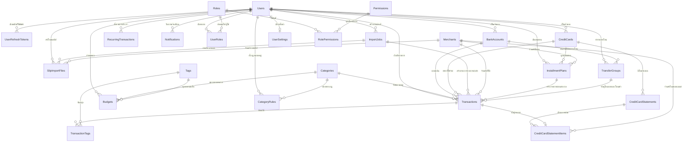

# Data Dictionary — ระบบบันทึกรายรับรายจ่าย (PocketWise)

> **วัตถุประสงค์:** อธิบายตารางและคอลัมน์ที่เสนอสำหรับระบบตาม Scope ในไฟล์ต้นทาง  
> **หมายเหตุสำคัญ:** เป็นแบบจำลองเริ่มต้นสำหรับ SQL Server; ต้องยืนยัน business rules และปรับชื่อ/ชนิดข้อมูลก่อนสร้างฐานข้อมูลจริง  
> **วิธีอ่าน:** PK = Primary Key; FK = Foreign Key; Nullable = อนุญาต NULL; Constraint = เงื่อนไข/ค่าเริ่มต้นที่เสนอ  
> **Google Sheets ต้นทาง:** [ระบบบันทึกรายรับรายจ่าย](https://docs.google.com/spreadsheets/d/11xfdjcAKEbh7a6l6B9u8y_1ksIM2il1xeDpOelm7KRw/edit) (ID: `11xfdjcAKEbh7a6l6B9u8y_1ksIM2il1xeDpOelm7KRw`)
> **ขอบเขตการ implement (อัปเดตตาม D13):** สร้าง Entity/ตารางจริง **ครบทั้ง 25 ตาราง** — รายการ FR ที่ผูกตารางแต่ละตารางดู badge "ขอบเขตฟีเจอร์" ของแต่ละตาราง + `/docs/REQUIREMENTS.md` (F7/F8 ครอบ Roles/Permissions/UserRoles/RolePermissions/AuditLogs — เพิ่มโดยเจ้าของโปรเจค)
> **หมายเหตุ D12:** คำสั่งเก่า "implement เฉพาะ 20/25 ตาราง" ถูก **ยกเลิก** แล้ว (เจ้าของโปรเจคเพิ่ม F7/F8) — ใช้ D13 แทน

---

## สารบัญตาราง (Table of Contents)

| ลำดับ | ชื่อตาราง | หน้าที่ | สถานะ | ขอบเขตฟีเจอร์ที่รองรับ |
|:---:|---|---|:---:|---|
| 1 | [Users](#users) | ข้อมูลผู้ใช้ | `คงไว้` | บัญชีผู้ใช้ โปรไฟล์ และอีเมลแจ้งเตือน |
| 2 | [Transactions](#transactions) | รายการรายรับรายจ่าย | `คงไว้และเพิ่ม FK` | รองรับรายการด้วยตนเอง สลิป บัตรเครดิต และการค้นหา |
| 3 | [Categories](#categories) | หมวดหมู่ | `คงไว้` | จัดหมวดหมู่และสรุปค่าใช้จ่าย |
| 4 | [Tags](#tags) | แท็ก | `คงไว้` | แท็กส่วนตัวและกรองรายการ |
| 5 | [TransactionTags](#transactiontags) | ความสัมพันธ์รายการกับแท็ก | `คงไว้` | รองรับหลายแท็กต่อรายการ |
| 6 | [BankAccounts](#bankaccounts) | บัญชีที่ใช้แยกแหล่งที่มาของรายการ | `คงไว้และเพิ่มข้อมูลธนาคาร` | กรองตามธนาคารและโอนระหว่างบัญชี |
| 7 | [Budgets](#budgets) | งบประมาณ | `คงไว้และเพิ่ม ScopeType` | งบรวม/หมวดหมู่/แท็ก และ threshold แจ้งเตือน |
| 8 | [RecurringTransactions](#recurringtransactions) | รายการที่ตั้งให้เกิดซ้ำ | `คงไว้` | สร้างรายการตามกำหนด |
| 9 | [Notifications](#notifications) | การแจ้งเตือน | `คงไว้` | บันทึกสถานะการแจ้งเตือนและส่งอีเมล |
| 10 | [UserSettings](#usersettings) | การตั้งค่าส่วนบุคคล | `คงไว้` | ธีม ภาษา สกุลเงิน และอีเมลแจ้งเตือน |
| 11 | [ImportJobs](#importjobs) | สถานะงานนำเข้าและผลการประมวลผล | `คงไว้และเพิ่มชนิดงาน` | ติดตามการนำเข้าสลิป/statement และรายการซ้ำ |
| 12 | [Roles](#roles) | บทบาทผู้ใช้ | `คงไว้` | กำหนดบทบาท (FR7.1) |
| 13 | [Permissions](#permissions) | รายการสิทธิ์ | `คงไว้` | กำหนดสิทธิ์ (FR7.2) |
| 14 | [UserRoles](#userroles) | ผู้ใช้กับบทบาท | `คงไว้` | ความสัมพันธ์ many-to-many (FR7.3) |
| 15 | [RolePermissions](#rolepermissions) | บทบาทกับสิทธิ์ | `คงไว้` | ความสัมพันธ์ many-to-many (FR7.4) |
| 16 | [CreditCards](#creditcards) | บัตรเครดิต | `เพิ่มใหม่` | แยกข้อมูลบัตร วันสรุปยอด และวงเงิน |
| 17 | [CreditCardStatements](#creditcardstatements) | ใบแจ้งยอดบัตรเครดิต | `เพิ่มใหม่` | เก็บหัว statement และยอดสรุป |
| 18 | [CreditCardStatementItems](#creditcardstatementitems) | รายการย่อยใบแจ้งยอด | `เพิ่มใหม่` | เก็บยอดซื้อ ดอกเบี้ย เงินคืน ยอดผ่อน และเชื่อม Transaction |
| 19 | [SlipImportFiles](#slipimportfiles) | ไฟล์สลิปและผล OCR | `เพิ่มใหม่` | เก็บตำแหน่งไฟล์ ชื่อผู้รับ ยอดเงิน hash และสถานะยืนยัน |
| 20 | [Merchants](#merchants) | ร้านค้า/ผู้รับเงิน | `เพิ่มใหม่` | ช่วยอ่านชื่อร้านและแนะนำหมวดหมู่ |
| 21 | [CategoryRules](#categoryrules) | กฎจัดหมวดหมู่อัตโนมัติ | `เพิ่มใหม่` | จำรูปแบบการจัดหมวดหมู่เพื่อใช้ครั้งถัดไป |
| 22 | [InstallmentPlans](#installmentplans) | แผนผ่อนบัตรเครดิต | `เพิ่มใหม่` | ติดตามยอดรวม จำนวนงวด และยอดต่อเดือน |
| 23 | [TransferGroups](#transfergroups) | กลุ่มการโอนระหว่างบัญชี | `เพิ่มใหม่` | จับคู่โอนออก/โอนเข้าไม่ให้คิดเป็นรายรับรายจ่ายซ้ำ |
| 24 | [AuditLogs](#auditlogs) | ประวัติการเปลี่ยนแปลง (ส่วนเสริม) | `เพิ่มใหม่` | ช่วยตรวจสอบการแก้ไขและนำเข้าข้อมูลย้อนหลัง (FR8.1–8.2) |
| 25 | [UserRefreshTokens](#userrefreshtokens) | เก็บ Refresh Token สำหรับต่ออายุ Access Token และจัดการเซสชันผู้ใช้ | `เพิ่มใหม่` | รองรับ JWT Authentication, Token Rotation, Multi-device Sessions และการ Revoke รายเครื่อง — **สร้างใน migration แรกเลย (D6)** |

---

## กฎและข้อกำหนดสำคัญของระบบ (System Rules & Architecture)

- **ความสัมพันธ์สำคัญ:** Transactions.UserId → Users.UserId; Transactions.CategoryId → Categories.CategoryId; TransactionTags เชื่อม Transactions กับ Tags; CreditCardStatements → CreditCards; CreditCardStatementItems → CreditCardStatements; SlipImportFiles → ImportJobs; Budgets เชื่อม Users กับ Category/Tag; Users ||--o{ UserRefreshTokens เชื่อมต่อการยืนยันตัวตนและจัดการเซสชัน
- **กติกาที่ต้องกำหนดในระบบ:** ตรวจรายการซ้ำด้วย FileHash/TransactionReference/จำนวนเงิน/เวลา; tag limit 20 tags ต่อผู้ใช้; การลบควรใช้ soft delete สำหรับรายการการเงิน; เก็บเวลาเป็น UTC และแสดงตาม timezone ผู้ใช้
- **การจัดการ Authentication & Refresh Token:**
  - ใช้ **Access Token (JWT)** อายุสั้น (เช่น 15-60 นาที) ควบคู่กับ **Refresh Token** อายุยาว (เช่น 7-30 วัน)
  - **ความปลอดภัยของ Refresh Token:** ห้ามจัดเก็บ Token ตัวเต็ม (Plain Text) ลงฐานข้อมูลเด็ดขาด ให้เก็บเป็น **SHA-256 Hash** (`TokenHash`)
  - **Token Rotation:** ทุกครั้งที่มีการขอ Access Token ใหม่ด้วย Refresh Token เดิม ให้ทำการยกเลิก Token เก่า (`RevokedAt`) และออก Token คู่ใหม่ทันที พร้อมบันทึก `ReplacedByTokenHash` เพื่อตรวจจับการนำ Token เก่ามาใช้ซ้ำ (Token Reuse / Theft Detection) หากพบการใช้ซ้ำ ให้สั่งเพิกถอน Token ทั้งหมดของผู้ใช้ทันที
  - **Multi-device Sessions:** ตาราง `UserRefreshTokens` รองรับการเข้าสู่ระบบพร้อมกันหลายเครื่อง (Mobile, Desktop) และสามารถเลือก Logout เฉพาะอุปกรณ์ได้
- **Timezone:** เก็บเวลาเป็น UTC ทั้งหมด (`datetime2`) และแสดงผลตาม timezone ของผู้ใช้
- **Soft Delete (ยึด D5 ล็อกแล้ว):** ใช้ soft delete (`IsDeleted`) **เฉพาะตารางกลุ่มการเงิน 9 ตาราง** = `Transactions`, `BankAccounts`, `CreditCards`, `Budgets`, `RecurringTransactions`, `InstallmentPlans`, `TransferGroups`, `CreditCardStatements`, `CreditCardStatementItems` — ทั้ง 9 ตารางนี้มีคอลัมน์ `IsDeleted` ครบแล้ว (เติมใน 7 ตารางที่ขาดใน Phase 2) + global query filter / ตารางอื่นใช้ hard delete ปกติ (ลบจริง)
- **ตรวจรายการซ้ำ (Duplicate Detection):** ตรวจสอบด้วย FileHash, TransactionReference, จำนวนเงิน และวันเวลา
- **Tag Limit:** กำหนดให้ไม่เกิน 20 tags ต่อผู้ใช้งาน

---

## แผนภาพความสัมพันธ์ฐานข้อมูล (Entity-Relationship Diagram)

---

## รายละเอียดตารางและคอลัมน์ (Table Specifications)

### 1. Users

> **ชื่อไทย:** Users — ข้อมูลผู้ใช้และโปรไฟล์  
> **หน้าที่:** ข้อมูลผู้ใช้ (คงไว้)  
> **ขอบเขตฟีเจอร์:** สมัคร/เข้าสู่ระบบ, โปรไฟล์, อีเมล, เบอร์มือถือ, วันเกิด

> [!TIP] สถาปัตยกรรม Refresh Token ร่วมกับตาราง Users
> **สถานะการตัดสินใจ: ล็อกแล้ว ✅ ใช้แนวทางที่ 1** (Decision D1 ใน playbook + JWT Bearer ทั้งระบบ) — เนื้อหา 2 แนวทางด้านล่างคงไว้เพื่อ refer ถึงเหตุผลของทางเลือก
> - **แนวทางที่ 1 (✅ ใช้นี้):** ใช้ตาราง [UserRefreshTokens](#userrefreshtokens) แบบ 1:N ช่วยให้ผู้ใช้สามารถล็อกอินได้หลายอุปกรณ์พร้อมกัน (Multi-device), รองรับ Token Rotation และเพิกถอน Token เฉพาะอุปกรณ์ได้
> - **แนวทางที่ 2 (ไม่ใช้ — คงไว้เป็นข้อมูล):** หากต้องการจำกัดให้ล็อกอินได้เพียงอุปกรณ์เดียวต่อบัญชี สามารถเพิ่มคอลัมน์ลงในตาราง Users โดยตรง ได้แก่ `RefreshTokenHash (nvarchar(128))`, `RefreshTokenExpiresAt (datetime2)`, และ `RefreshTokenCreatedAt (datetime2)`

| Column | Data Type | PK | FK | Nullable | Default / Constraint | รายละเอียด | ตัวอย่าง |
|---|---|:---:|---|:---:|---|---|---|
| `UserId` | `bigint` | ✓ |  | NO | IDENTITY(1,1) | รหัสผู้ใช้ | 1001 |
| `Email` | `nvarchar(256)` |  |  | NO | UNIQUE; normalized for login | อีเมลผู้ใช้ ใช้เข้าสู่ระบบและส่งแจ้งเตือน | user@example.com |
| `PasswordHash` | `nvarchar(500)` |  |  | NO |  | รหัสผ่านที่ผ่านการ hash ห้ามเก็บรหัสผ่าน plain text | &lt;hash&gt; |
| `DisplayName` | `nvarchar(150)` |  |  | NO |  | ชื่อที่แสดง | สมชาย |
| `PhoneNumber` | `nvarchar(30)` |  |  | YES |  | เบอร์มือถือ | 0812345678 |
| `BirthDate` | `date` |  |  | YES |  | วันเกิด | 1998-01-15 |
| `IsEmailVerified` | `bit` |  |  | NO | DEFAULT 0 | ยืนยันอีเมลแล้วหรือไม่ | 0 |
| `IsActive` | `bit` |  |  | NO | DEFAULT 1 | สถานะบัญชี | 1 |
| `CreatedAt` | `datetime2` |  |  | NO | DEFAULT SYSUTCDATETIME() | วันเวลาสร้างข้อมูล | 2026-10-16T10:00:00Z |
| `UpdatedAt` | `datetime2` |  |  | YES |  | วันเวลาแก้ไขล่าสุด | 2026-10-16T10:30:00Z |

### 2. Transactions

> **ชื่อไทย:** Transactions — รายการรายรับ รายจ่าย และรายการที่นำเข้าจากสลิป/ใบแจ้งยอด  
> **หน้าที่:** รายการรายรับรายจ่าย (คงไว้และเพิ่ม FK)  
> **ขอบเขตฟีเจอร์:** เพิ่ม/แก้ไขรายการ, รายรับรายจ่าย, เงินสด, บัตรเครดิต, ค้นหา, กรอง, จัดหมวดหมู่

| Column | Data Type | PK | FK | Nullable | Default / Constraint | รายละเอียด | ตัวอย่าง |
|---|---|:---:|---|:---:|---|---|---|
| `TransactionId` | `bigint` | ✓ |  | NO | IDENTITY(1,1) | รหัสรายการ | 50001 |
| `UserId` | `bigint` |  | `Users.UserId` | NO |  | เจ้าของรายการ | 1001 |
| `TransactionType` | `varchar(20)` |  |  | NO | CHECK INCOME/EXPENSE/TRANSFER | ประเภทรายการ | EXPENSE |
| `Amount` | `decimal(18,2)` |  |  | NO | CHECK Amount > 0 | จำนวนเงินเป็นค่าบวก ใช้ประเภทกำหนดความหมาย | 1250.00 |
| `CurrencyCode` | `char(3)` |  |  | NO | DEFAULT 'THB' | รหัสสกุลเงิน ISO | THB |
| `TransactionDate` | `datetime2` |  |  | NO |  | วันที่/เวลาที่เกิดรายการ | 2026-10-15T18:30:00 |
| `Description` | `nvarchar(500)` |  |  | YES |  | รายละเอียดรายการ | ค่าอาหาร |
| `CategoryId` | `bigint` |  | `Categories.CategoryId` | YES |  | หมวดหมู่รายการ | 12 |
| `MerchantId` | `bigint` |  | `Merchants.MerchantId` | YES |  | ร้านค้าหรือผู้รับเงิน | 55 |
| `BankAccountId` | `bigint` |  | `BankAccounts.BankAccountId` | YES |  | บัญชีธนาคาร/แหล่งเงินที่เกี่ยวข้อง | 8 |
| `CreditCardId` | `bigint` |  | `CreditCards.CreditCardId` | YES |  | บัตรเครดิตที่เกี่ยวข้อง | 3 |
| `SourceType` | `varchar(30)` |  |  | NO | MANUAL/SLIP/CARD_STATEMENT/RECURRING | แหล่งที่มาของรายการ | SLIP |
| `ImportJobId` | `bigint` |  | `ImportJobs.ImportJobId` | YES |  | งานนำเข้าที่สร้างรายการนี้ | 900 |
| `SlipImportFileId` | `bigint` |  | `SlipImportFiles.SlipImportFileId` | YES |  | ไฟล์สลิปต้นทาง | 41 |
| `StatementItemId` | `bigint` |  | `CreditCardStatementItems.StatementItemId` | YES |  | รายการต้นทางจากใบแจ้งยอดบัตร | 71 |
| `TransferGroupId` | `bigint` |  | `TransferGroups.TransferGroupId` | YES |  | กลุ่มรายการโอนระหว่างบัญชี | 20 |
| `RecurringTransactionId` | `bigint` |  | `RecurringTransactions.RecurringTransactionId` | YES |  | แม่แบบรายการประจำ | 15 |
| `Status` | `varchar(20)` |  |  | NO | DEFAULT 'CONFIRMED'; DRAFT/CONFIRMED/VOID | สถานะรายการ | CONFIRMED |
| `IsDeleted` | `bit` |  |  | NO | DEFAULT 0 | ลบแบบ soft delete | 0 |
| `CreatedAt` | `datetime2` |  |  | NO | DEFAULT SYSUTCDATETIME() | วันเวลาสร้าง | 2026-10-16T10:00:00Z |
| `UpdatedAt` | `datetime2` |  |  | YES |  | วันเวลาแก้ไข | 2026-10-16T10:30:00Z |

### 3. Categories

> **ชื่อไทย:** Categories — หมวดหมู่รายรับรายจ่าย  
> **หน้าที่:** หมวดหมู่ (คงไว้)  
> **ขอบเขตฟีเจอร์:** สร้าง/แก้ไข/เรียงลำดับหมวดหมู่ และช่วยจัดหมวดหมู่อัตโนมัติ

| Column | Data Type | PK | FK | Nullable | Default / Constraint | รายละเอียด | ตัวอย่าง |
|---|---|:---:|---|:---:|---|---|---|
| `CategoryId` | `bigint` | ✓ |  | NO | IDENTITY(1,1) | รหัสหมวดหมู่ | 12 |
| `UserId` | `bigint` |  | `Users.UserId` | YES |  | เจ้าของหมวดหมู่; NULL ใช้หมวดหมู่ระบบ | 1001 |
| `CategoryName` | `nvarchar(100)` |  |  | NO |  | ชื่อหมวดหมู่ | อาหาร |
| `CategoryType` | `varchar(20)` |  |  | NO | INCOME/EXPENSE/BOTH | ใช้กับรายรับหรือรายจ่าย | EXPENSE |
| `Icon` | `nvarchar(100)` |  |  | YES |  | ชื่อไอคอน | utensils |
| `Color` | `varchar(20)` |  |  | YES |  | รหัสสีสำหรับ UI | #FFC5C5 |
| `SortOrder` | `int` |  |  | NO | DEFAULT 0 | ลำดับการแสดง | 1 |
| `IsSystem` | `bit` |  |  | NO | DEFAULT 0 | เป็นหมวดหมู่มาตรฐานหรือไม่ | 0 |
| `IsActive` | `bit` |  |  | NO | DEFAULT 1 | เปิดใช้งานหรือไม่ | 1 |
| `CreatedAt` | `datetime2` |  |  | NO | DEFAULT SYSUTCDATETIME() | วันเวลาสร้าง | 2026-10-16T10:00:00Z |

### 4. Tags

> **ชื่อไทย:** Tags — แท็กที่ผู้ใช้สร้างและจัดการเอง  
> **หน้าที่:** แท็ก (คงไว้)  
> **ขอบเขตฟีเจอร์:** สร้าง/แก้ไข/ลบ/เรียงแท็ก, ค้นหาและกรอง, จำกัดจำนวนแท็ก

| Column | Data Type | PK | FK | Nullable | Default / Constraint | รายละเอียด | ตัวอย่าง |
|---|---|:---:|---|:---:|---|---|---|
| `TagId` | `bigint` | ✓ |  | NO | IDENTITY(1,1) | รหัสแท็ก | 21 |
| `UserId` | `bigint` |  | `Users.UserId` | NO |  | เจ้าของแท็ก | 1001 |
| `TagName` | `nvarchar(50)` |  |  | NO | UNIQUE per UserId | ชื่อแท็ก ไม่จำเป็นต้องเก็บ # นำหน้า | เที่ยวญี่ปุ่น |
| `Color` | `varchar(20)` |  |  | YES |  | สีแท็ก |  #C7DCA7 |
| `SortOrder` | `int` |  |  | NO | DEFAULT 0 | ลำดับแสดงผล | 1 |
| `CreatedAt` | `datetime2` |  |  | NO | DEFAULT SYSUTCDATETIME() | วันเวลาสร้าง | 2026-10-16T10:00:00Z |

### 5. TransactionTags

> **ชื่อไทย:** TransactionTags — ตารางเชื่อมรายการกับแท็กแบบ many-to-many  
> **หน้าที่:** ความสัมพันธ์รายการกับแท็ก (คงไว้)  
> **ขอบเขตฟีเจอร์:** ติดแท็กหลายแท็กต่อรายการและกรองตามแท็ก

| Column | Data Type | PK | FK | Nullable | Default / Constraint | รายละเอียด | ตัวอย่าง |
|---|---|:---:|---|:---:|---|---|---|
| `TransactionId` | `bigint` | ✓ | `Transactions.TransactionId` | NO | Composite PK | รายการ | 50001 |
| `TagId` | `bigint` | ✓ | `Tags.TagId` | NO | Composite PK | แท็ก | 21 |
| `CreatedAt` | `datetime2` |  |  | NO | DEFAULT SYSUTCDATETIME() | วันเวลาผูกแท็ก | 2026-10-16T10:00:00Z |

### 6. BankAccounts

> **ชื่อไทย:** BankAccounts — บัญชีธนาคารและแหล่งเงินของผู้ใช้  
> **หน้าที่:** บัญชีที่ใช้แยกแหล่งที่มาของรายการ (คงไว้และเพิ่มข้อมูลธนาคาร)  
> **ขอบเขตฟีเจอร์:** แยกดูรายการตามธนาคารและโอนเงินระหว่างบัญชี

| Column | Data Type | PK | FK | Nullable | Default / Constraint | รายละเอียด | ตัวอย่าง |
|---|---|:---:|---|:---:|---|---|---|
| `BankAccountId` | `bigint` | ✓ |  | NO | IDENTITY(1,1) | รหัสบัญชี | 8 |
| `UserId` | `bigint` |  | `Users.UserId` | NO |  | เจ้าของบัญชี | 1001 |
| `BankCode` | `varchar(30)` |  |  | YES |  | รหัสธนาคาร | KBANK |
| `BankName` | `nvarchar(100)` |  |  | NO |  | ชื่อธนาคาร | ธนาคารกสิกรไทย |
| `AccountName` | `nvarchar(100)` |  |  | NO |  | ชื่อเรียกบัญชี | บัญชีเงินเดือน |
| `AccountNumberMasked` | `nvarchar(30)` |  |  | YES |  | เลขบัญชีแบบปกปิดข้อมูล | xxx-x-x1234 |
| `AccountType` | `varchar(30)` |  |  | NO | CASH/BANK/WALLET/OTHER | ประเภทแหล่งเงิน | BANK |
| `IsActive` | `bit` |  |  | NO | DEFAULT 1 | สถานะบัญชี | 1 |
| `CreatedAt` | `datetime2` |  |  | NO | DEFAULT SYSUTCDATETIME() | วันเวลาสร้าง | 2026-10-16T10:00:00Z |

### 7. Budgets

> **ชื่อไทย:** Budgets — งบประมาณรวม หมวดหมู่ หรือแท็ก  
> **หน้าที่:** งบประมาณ (คงไว้และเพิ่ม ScopeType)  
> **ขอบเขตฟีเจอร์:** ตั้งงบ, ติดตามยอดใช้, แจ้งเตือนใกล้ถึงงบ, แก้ไข/ลบงบ

| Column | Data Type | PK | FK | Nullable | Default / Constraint | รายละเอียด | ตัวอย่าง |
|---|---|:---:|---|:---:|---|---|---|
| `BudgetId` | `bigint` | ✓ |  | NO | IDENTITY(1,1) | รหัสงบประมาณ | 30 |
| `UserId` | `bigint` |  | `Users.UserId` | NO |  | เจ้าของงบ | 1001 |
| `BudgetName` | `nvarchar(150)` |  |  | NO |  | ชื่อแผนงบ | งบอาหารต่อเดือน |
| `ScopeType` | `varchar(20)` |  |  | NO | TOTAL/CATEGORY/TAG | ขอบเขตงบ | CATEGORY |
| `CategoryId` | `bigint` |  | `Categories.CategoryId` | YES | Required when ScopeType=CATEGORY | หมวดหมู่ที่กำหนดงบ | 12 |
| `TagId` | `bigint` |  | `Tags.TagId` | YES | Required when ScopeType=TAG | แท็กที่กำหนดงบ | 21 |
| `AmountLimit` | `decimal(18,2)` |  |  | NO | CHECK > 0 | วงเงินงบประมาณ | 5000.00 |
| `PeriodType` | `varchar(20)` |  |  | NO | WEEKLY/MONTHLY/QUARTERLY/YEARLY/CUSTOM | รอบงบ | MONTHLY |
| `StartDate` | `date` |  |  | NO |  | วันที่เริ่มรอบงบ | 2026-10-01 |
| `EndDate` | `date` |  |  | YES | Must be >= StartDate | วันที่สิ้นสุดรอบงบ; NULL สำหรับรอบซ้ำ | 2026-10-31 |
| `AlertThresholdPercent` | `tinyint` |  |  | NO | DEFAULT 80; 1..100 | เปอร์เซ็นต์ที่เริ่มแจ้งเตือน | 80 |
| `IsActive` | `bit` |  |  | NO | DEFAULT 1 | สถานะงบ | 1 |
| `IsDeleted` | `bit` |  |  | NO | DEFAULT 0 | ลบแบบ soft delete | 0 |
| `CreatedAt` | `datetime2` |  |  | NO | DEFAULT SYSUTCDATETIME() | วันเวลาสร้าง | 2026-10-16T10:00:00Z |

### 8. RecurringTransactions

> **ชื่อไทย:** RecurringTransactions — แม่แบบรายการที่เกิดซ้ำตามกำหนด  
> **หน้าที่:** รายการที่ตั้งให้เกิดซ้ำ (คงไว้)  
> **ขอบเขตฟีเจอร์:** ตั้งรายการล่วงหน้า เช่น ค่าเช่า/ค่าสมาชิก

| Column | Data Type | PK | FK | Nullable | Default / Constraint | รายละเอียด | ตัวอย่าง |
|---|---|:---:|---|:---:|---|---|---|
| `RecurringTransactionId` | `bigint` | ✓ |  | NO | IDENTITY(1,1) | รหัสรายการประจำ | 15 |
| `UserId` | `bigint` |  | `Users.UserId` | NO |  | เจ้าของรายการ | 1001 |
| `TransactionType` | `varchar(20)` |  |  | NO | INCOME/EXPENSE | ประเภทรายการ | EXPENSE |
| `Amount` | `decimal(18,2)` |  |  | NO | CHECK > 0 | จำนวนเงิน | 350.00 |
| `Description` | `nvarchar(500)` |  |  | YES |  | รายละเอียด | ค่าสมาชิก |
| `CategoryId` | `bigint` |  | `Categories.CategoryId` | YES |  | หมวดหมู่ | 12 |
| `Frequency` | `varchar(20)` |  |  | NO | DAILY/WEEKLY/MONTHLY/QUARTERLY/YEARLY | ความถี่ | MONTHLY |
| `IntervalValue` | `int` |  |  | NO | DEFAULT 1; CHECK > 0 | ทุกกี่หน่วยความถี่ | 1 |
| `StartDate` | `date` |  |  | NO |  | วันที่เริ่ม | 2026-10-01 |
| `EndDate` | `date` |  |  | YES |  | วันที่สิ้นสุด | 2027-09-30 |
| `NextRunAt` | `datetime2` |  |  | NO |  | เวลาที่ต้องสร้างรายการครั้งถัดไป | 2026-11-01T00:00:00 |
| `IsActive` | `bit` |  |  | NO | DEFAULT 1 | สถานะการทำงาน | 1 |
| `IsDeleted` | `bit` |  |  | NO | DEFAULT 0 | ลบแบบ soft delete | 0 |
| `CreatedAt` | `datetime2` |  |  | NO | DEFAULT SYSUTCDATETIME() | วันเวลาสร้าง | 2026-10-16T10:00:00Z |

### 9. Notifications

> **ชื่อไทย:** Notifications — การแจ้งเตือนภายในระบบและสถานะการส่งอีเมล  
> **หน้าที่:** การแจ้งเตือน (คงไว้)  
> **ขอบเขตฟีเจอร์:** แจ้งเตือนงบประมาณใกล้ถึงขีดจำกัดผ่านอีเมล

| Column | Data Type | PK | FK | Nullable | Default / Constraint | รายละเอียด | ตัวอย่าง |
|---|---|:---:|---|:---:|---|---|---|
| `NotificationId` | `bigint` | ✓ |  | NO | IDENTITY(1,1) | รหัสแจ้งเตือน | 61 |
| `UserId` | `bigint` |  | `Users.UserId` | NO |  | ผู้รับแจ้งเตือน | 1001 |
| `NotificationType` | `varchar(50)` |  |  | NO |  | ประเภทการแจ้งเตือน | BUDGET_THRESHOLD |
| `Title` | `nvarchar(200)` |  |  | NO |  | หัวข้อ | งบอาหารใกล้เต็ม |
| `Message` | `nvarchar(1000)` |  |  | NO |  | ข้อความแจ้งเตือน | ใช้เงินไปแล้ว 80% ของงบ |
| `Channel` | `varchar(20)` |  |  | NO | IN_APP/EMAIL | ช่องทาง | EMAIL |
| `Status` | `varchar(20)` |  |  | NO | PENDING/SENT/FAILED/READ | สถานะส่ง/อ่าน | SENT |
| `RelatedEntityType` | `varchar(50)` |  |  | YES |  | ชนิดข้อมูลอ้างอิง | Budget |
| `RelatedEntityId` | `bigint` |  |  | YES |  | รหัสข้อมูลอ้างอิง | 30 |
| `SentAt` | `datetime2` |  |  | YES |  | เวลาส่ง | 2026-10-16T10:00:00Z |
| `ReadAt` | `datetime2` |  |  | YES |  | เวลาอ่าน | 2026-10-16T10:10:00Z |
| `CreatedAt` | `datetime2` |  |  | NO | DEFAULT SYSUTCDATETIME() | วันเวลาสร้าง | 2026-10-16T10:00:00Z |

### 10. UserSettings

> **ชื่อไทย:** UserSettings — ค่าตั้งค่าส่วนบุคคล  
> **หน้าที่:** การตั้งค่าส่วนบุคคล (คงไว้)  
> **ขอบเขตฟีเจอร์:** ธีม Dark/Light, ค่าตั้งค่าแอป, ล้างข้อมูลตามสิทธิ์

| Column | Data Type | PK | FK | Nullable | Default / Constraint | รายละเอียด | ตัวอย่าง |
|---|---|:---:|---|:---:|---|---|---|
| `UserId` | `bigint` | ✓ | `Users.UserId` | NO | PK and FK | ผู้ใช้เจ้าของค่าตั้งค่า | 1001 |
| `Theme` | `varchar(10)` |  |  | NO | DEFAULT 'LIGHT'; LIGHT/DARK | ธีมแอป | DARK |
| `CurrencyCode` | `char(3)` |  |  | NO | DEFAULT 'THB' | สกุลเงินหลัก | THB |
| `Locale` | `varchar(10)` |  |  | NO | DEFAULT 'th-TH' | ภาษาและรูปแบบท้องถิ่น | th-TH |
| `EmailBudgetAlertsEnabled` | `bit` |  |  | NO | DEFAULT 1 | เปิดรับอีเมลแจ้งเตือนงบหรือไม่ | 1 |
| `UpdatedAt` | `datetime2` |  |  | NO | DEFAULT SYSUTCDATETIME() | วันเวลาแก้ไข | 2026-10-16T10:00:00Z |

### 11. ImportJobs

> **ชื่อไทย:** ImportJobs — ติดตามงานนำเข้าข้อมูลและผลการประมวลผล  
> **หน้าที่:** สถานะงานนำเข้าและผลการประมวลผล (คงไว้และเพิ่มชนิดงาน)  
> **ขอบเขตฟีเจอร์:** นำเข้าสลิป/ใบแจ้งยอด, ตรวจสอบรายการซ้ำ, สถานะงานนำเข้า

| Column | Data Type | PK | FK | Nullable | Default / Constraint | รายละเอียด | ตัวอย่าง |
|---|---|:---:|---|:---:|---|---|---|
| `ImportJobId` | `bigint` | ✓ |  | NO | IDENTITY(1,1) | รหัสงานนำเข้า | 900 |
| `UserId` | `bigint` |  | `Users.UserId` | NO |  | ผู้เริ่มนำเข้า | 1001 |
| `ImportType` | `varchar(30)` |  |  | NO | SLIP/CARD_STATEMENT | ประเภทนำเข้า | SLIP |
| `FileName` | `nvarchar(260)` |  |  | YES |  | ชื่อไฟล์ต้นฉบับ | slip_20261015.jpg |
| `Status` | `varchar(20)` |  |  | NO | PENDING/PROCESSING/NEEDS_REVIEW/COMPLETED/FAILED | สถานะงาน | NEEDS_REVIEW |
| `TotalRecords` | `int` |  |  | NO | DEFAULT 0 | จำนวนรายการที่อ่านได้ | 1 |
| `ImportedRecords` | `int` |  |  | NO | DEFAULT 0 | จำนวนรายการที่บันทึกสำเร็จ | 1 |
| `DuplicateRecords` | `int` |  |  | NO | DEFAULT 0 | จำนวนรายการซ้ำ | 0 |
| `ErrorMessage` | `nvarchar(2000)` |  |  | YES |  | รายละเอียดข้อผิดพลาด |  |
| `StartedAt` | `datetime2` |  |  | YES |  | เวลาเริ่มประมวลผล | 2026-10-16T10:00:00Z |
| `CompletedAt` | `datetime2` |  |  | YES |  | เวลาสิ้นสุด | 2026-10-16T10:00:03Z |
| `CreatedAt` | `datetime2` |  |  | NO | DEFAULT SYSUTCDATETIME() | วันเวลาสร้างงาน | 2026-10-16T10:00:00Z |

### 12. Roles

> **ชื่อไทย:** Roles — บทบาทผู้ใช้  
> **หน้าที่:** บทบาทผู้ใช้ (คงไว้)  
> **ขอบเขตฟีเจอร์:** กำหนดสิทธิ์การเข้าถึงระบบ (FR7.1)

| Column | Data Type | PK | FK | Nullable | Default / Constraint | รายละเอียด | ตัวอย่าง |
|---|---|:---:|---|:---:|---|---|---|
| `RoleId` | `int` | ✓ |  | NO | IDENTITY(1,1) | รหัสบทบาท | 1 |
| `RoleName` | `nvarchar(100)` |  |  | NO | UNIQUE | ชื่อบทบาท | Admin |
| `Description` | `nvarchar(255)` |  |  | YES |  | คำอธิบาย | ผู้ดูแลระบบ |
| `IsActive` | `bit` |  |  | NO | DEFAULT 1 | สถานะ | 1 |
| `CreatedAt` | `datetime2` |  |  | NO | DEFAULT SYSUTCDATETIME() | วันที่สร้าง | 2026-10-16T10:00:00Z |
| `UpdatedAt` | `datetime2` |  |  | YES |  | วันที่แก้ไข | 2026-10-16T10:00:00Z |

### 13. Permissions

> **ชื่อไทย:** Permissions — รายการสิทธิ์ที่ระบบอนุญาต  
> **หน้าที่:** รายการสิทธิ์ (คงไว้)  
> **ขอบเขตฟีเจอร์:** กำหนดสิทธิ์ดู/เพิ่ม/แก้ไข/ลบข้อมูล (FR7.2)

| Column | Data Type | PK | FK | Nullable | Default / Constraint | รายละเอียด | ตัวอย่าง |
|---|---|:---:|---|:---:|---|---|---|
| `PermissionId` | `int` | ✓ |  | NO | IDENTITY(1,1) | รหัสสิทธิ์ | 1 |
| `PermissionCode` | `nvarchar(100)` |  |  | NO | UNIQUE | รหัสสิทธิ์ที่ไม่ซ้ำ | TRANSACTION_CREATE |
| `PermissionName` | `nvarchar(150)` |  |  | NO |  | ชื่อสิทธิ์ | เพิ่มรายการ |
| `Module` | `nvarchar(100)` |  |  | NO |  | โมดูลที่เกี่ยวข้อง | Transactions |
| `Description` | `nvarchar(255)` |  |  | YES |  | คำอธิบาย | อนุญาตให้เพิ่มรายการ |
| `CreatedAt` | `datetime2` |  |  | NO | DEFAULT SYSUTCDATETIME() | วันที่สร้าง | 2026-10-16T10:00:00Z |

### 14. UserRoles

> **ชื่อไทย:** UserRoles — เชื่อมผู้ใช้กับบทบาท  
> **หน้าที่:** ผู้ใช้กับบทบาท (คงไว้)  
> **ขอบเขตฟีเจอร์:** กำหนดหนึ่งหรือหลายบทบาทให้ผู้ใช้ (FR7.3)

| Column | Data Type | PK | FK | Nullable | Default / Constraint | รายละเอียด | ตัวอย่าง |
|---|---|:---:|---|:---:|---|---|---|
| `UserId` | `bigint` | ✓ | `Users.UserId` | NO | Composite PK | ผู้ใช้ | 1001 |
| `RoleId` | `int` | ✓ | `Roles.RoleId` | NO | Composite PK | บทบาท | 1 |
| `AssignedAt` | `datetime2` |  |  | NO | DEFAULT SYSUTCDATETIME() | เวลาที่กำหนดบทบาท | 2026-10-16T10:00:00Z |

### 15. RolePermissions

> **ชื่อไทย:** RolePermissions — เชื่อมบทบาทกับสิทธิ์  
> **หน้าที่:** บทบาทกับสิทธิ์ (คงไว้)  
> **ขอบเขตฟีเจอร์:** กำหนดสิทธิ์แต่ละบทบาท (FR7.4)

| Column | Data Type | PK | FK | Nullable | Default / Constraint | รายละเอียด | ตัวอย่าง |
|---|---|:---:|---|:---:|---|---|---|
| `RoleId` | `int` | ✓ | `Roles.RoleId` | NO | Composite PK | บทบาท | 1 |
| `PermissionId` | `int` | ✓ | `Permissions.PermissionId` | NO | Composite PK | สิทธิ์ | 1 |
| `CreatedAt` | `datetime2` |  |  | NO | DEFAULT SYSUTCDATETIME() | วันที่กำหนดสิทธิ์ | 2026-10-16T10:00:00Z |

### 16. CreditCards

> **ชื่อไทย:** CreditCards — ข้อมูลบัตรเครดิตของผู้ใช้  
> **หน้าที่:** บัตรเครดิต (เพิ่มใหม่)  
> **ขอบเขตฟีเจอร์:** เพิ่มรายจ่ายบัตรเครดิต, แยกดูค่าใช้จ่ายบัตรเครดิต

| Column | Data Type | PK | FK | Nullable | Default / Constraint | รายละเอียด | ตัวอย่าง |
|---|---|:---:|---|:---:|---|---|---|
| `CreditCardId` | `bigint` | ✓ |  | NO | IDENTITY(1,1) | รหัสบัตรเครดิต | 3 |
| `UserId` | `bigint` |  | `Users.UserId` | NO |  | เจ้าของบัตร | 1001 |
| `BankName` | `nvarchar(100)` |  |  | NO |  | ธนาคารผู้ออกบัตร | ธนาคารกสิกรไทย |
| `CardName` | `nvarchar(100)` |  |  | NO |  | ชื่อเรียกบัตร | บัตรเครดิตหลัก |
| `CardNumberMasked` | `nvarchar(30)` |  |  | YES |  | เลขบัตรแบบปกปิด ห้ามเก็บเลขเต็มถ้าไม่จำเป็น | **** **** **** 1234 |
| `BillingDay` | `tinyint` |  |  | YES | 1..31 | วันสรุปยอด | 25 |
| `PaymentDueDay` | `tinyint` |  |  | YES | 1..31 | วันครบกำหนดชำระ | 10 |
| `CreditLimit` | `decimal(18,2)` |  |  | YES | CHECK >= 0 | วงเงินบัตร | 50000.00 |
| `IsActive` | `bit` |  |  | NO | DEFAULT 1 | สถานะบัตร | 1 |
| `IsDeleted` | `bit` |  |  | NO | DEFAULT 0 | ลบแบบ soft delete | 0 |
| `CreatedAt` | `datetime2` |  |  | NO | DEFAULT SYSUTCDATETIME() | วันเวลาสร้าง | 2026-10-16T10:00:00Z |

### 17. CreditCardStatements

> **ชื่อไทย:** CreditCardStatements — หัวใบแจ้งยอดบัตรเครดิตที่นำเข้า  
> **หน้าที่:** ใบแจ้งยอดบัตรเครดิต (เพิ่มใหม่)  
> **ขอบเขตฟีเจอร์:** นำเข้าใบแจ้งยอดบัตรเครดิตและติดตามยอดเรียกเก็บ

| Column | Data Type | PK | FK | Nullable | Default / Constraint | รายละเอียด | ตัวอย่าง |
|---|---|:---:|---|:---:|---|---|---|
| `StatementId` | `bigint` | ✓ |  | NO | IDENTITY(1,1) | รหัสใบแจ้งยอด | 70 |
| `CreditCardId` | `bigint` |  | `CreditCards.CreditCardId` | NO |  | บัตรที่เป็นเจ้าของใบแจ้งยอด | 3 |
| `ImportJobId` | `bigint` |  | `ImportJobs.ImportJobId` | YES |  | งานนำเข้า | 901 |
| `StatementPeriodStart` | `date` |  |  | NO |  | วันเริ่มรอบรายการ | 2026-09-26 |
| `StatementPeriodEnd` | `date` |  |  | NO |  | วันสิ้นสุดรอบรายการ | 2026-10-25 |
| `StatementDate` | `date` |  |  | NO |  | วันที่ออกใบแจ้งยอด | 2026-10-25 |
| `PaymentDueDate` | `date` |  |  | YES |  | วันครบกำหนดชำระ | 2026-11-10 |
| `PreviousBalance` | `decimal(18,2)` |  |  | NO | DEFAULT 0 | ยอดยกมา | 1200.00 |
| `PurchaseAmount` | `decimal(18,2)` |  |  | NO | DEFAULT 0 | ยอดซื้อรวม | 3500.00 |
| `InstallmentAmount` | `decimal(18,2)` |  |  | NO | DEFAULT 0 | ยอดผ่อนงวดนี้ | 500.00 |
| `InterestAmount` | `decimal(18,2)` |  |  | NO | DEFAULT 0 | ดอกเบี้ย | 50.00 |
| `CashbackAmount` | `decimal(18,2)` |  |  | NO | DEFAULT 0 | เงินคืน | 100.00 |
| `PaymentAmount` | `decimal(18,2)` |  |  | NO | DEFAULT 0 | ยอดชำระ | 2000.00 |
| `TotalDue` | `decimal(18,2)` |  |  | NO |  | ยอดที่ต้องชำระตามใบแจ้งยอด | 3150.00 |
| `Status` | `varchar(20)` |  |  | NO | IMPORTED/REVIEWED/PAID | สถานะใบแจ้งยอด | REVIEWED |
| `IsDeleted` | `bit` |  |  | NO | DEFAULT 0 | ลบแบบ soft delete | 0 |
| `CreatedAt` | `datetime2` |  |  | NO | DEFAULT SYSUTCDATETIME() | วันเวลานำเข้า | 2026-10-26T10:00:00Z |

### 18. CreditCardStatementItems

> **ชื่อไทย:** CreditCardStatementItems — รายละเอียดแต่ละรายการในใบแจ้งยอด  
> **หน้าที่:** รายการย่อยใบแจ้งยอด (เพิ่มใหม่)  
> **ขอบเขตฟีเจอร์:** นำเข้ารายการซื้อ ดอกเบี้ย เงินคืน และยอดผ่อนจากใบแจ้งยอด

| Column | Data Type | PK | FK | Nullable | Default / Constraint | รายละเอียด | ตัวอย่าง |
|---|---|:---:|---|:---:|---|---|---|
| `StatementItemId` | `bigint` | ✓ |  | NO | IDENTITY(1,1) | รหัสรายการย่อย | 71 |
| `StatementId` | `bigint` |  | `CreditCardStatements.StatementId` | NO |  | ใบแจ้งยอดต้นทาง | 70 |
| `TransactionDate` | `date` |  |  | NO |  | วันที่ทำรายการ | 2026-10-02 |
| `Description` | `nvarchar(500)` |  |  | NO |  | รายละเอียดจากใบแจ้งยอด | ร้านค้า ABC |
| `ItemType` | `varchar(30)` |  |  | NO | PURCHASE/INSTALLMENT/INTEREST/CASHBACK/FEE/PAYMENT/OTHER | ชนิดรายการ | PURCHASE |
| `Amount` | `decimal(18,2)` |  |  | NO |  | จำนวนเงินตาม statement; เก็บค่าบวกและใช้ ItemType แยกความหมาย | 850.00 |
| `MerchantId` | `bigint` |  | `Merchants.MerchantId` | YES |  | ร้านค้าที่จับคู่ได้ | 55 |
| `InstallmentPlanId` | `bigint` |  | `InstallmentPlans.InstallmentPlanId` | YES |  | แผนผ่อนที่เกี่ยวข้อง | 2 |
| `TransactionId` | `bigint` |  | `Transactions.TransactionId` | YES | UNIQUE when linked | รายการที่สร้างในระบบหลังยืนยัน | 50002 |
| `ExternalReference` | `nvarchar(150)` |  |  | YES |  | เลขอ้างอิงจากไฟล์ต้นทาง | REF-ABC123 |
| `IsDuplicate` | `bit` |  |  | NO | DEFAULT 0 | ตรวจพบว่าซ้ำหรือไม่ | 0 |
| `IsDeleted` | `bit` |  |  | NO | DEFAULT 0 | ลบแบบ soft delete | 0 |
| `CreatedAt` | `datetime2` |  |  | NO | DEFAULT SYSUTCDATETIME() | เวลานำเข้า | 2026-10-26T10:00:00Z |

### 19. SlipImportFiles

> **ชื่อไทย:** SlipImportFiles — ไฟล์สลิปที่อัปโหลดและข้อมูลที่อ่านได้จาก OCR  
> **หน้าที่:** ไฟล์สลิปและผล OCR (เพิ่มใหม่)  
> **ขอบเขตฟีเจอร์:** อัปโหลดสลิป, อ่านชื่อผู้รับ/ยอดเงิน, ยืนยันข้อมูล, ตรวจสอบรายการซ้ำ

| Column | Data Type | PK | FK | Nullable | Default / Constraint | รายละเอียด | ตัวอย่าง |
|---|---|:---:|---|:---:|---|---|---|
| `SlipImportFileId` | `bigint` | ✓ |  | NO | IDENTITY(1,1) | รหัสไฟล์สลิป | 41 |
| `UserId` | `bigint` |  | `Users.UserId` | NO |  | ผู้เป็นเจ้าของไฟล์ | 1001 |
| `ImportJobId` | `bigint` |  | `ImportJobs.ImportJobId` | YES |  | งานนำเข้าที่เกี่ยวข้อง | 900 |
| `StorageKey` | `nvarchar(500)` |  |  | NO | UNIQUE | ตำแหน่งจัดเก็บไฟล์หรือ object key; ไม่เก็บ binary ในตารางถ้าใช้ object storage | slips/1001/2026/10/abc.jpg |
| `OriginalFileName` | `nvarchar(260)` |  |  | NO |  | ชื่อไฟล์เดิม | transfer.jpg |
| `MimeType` | `varchar(100)` |  |  | NO |  | ชนิดไฟล์ | image/jpeg |
| `FileSizeBytes` | `bigint` |  |  | NO | CHECK > 0 | ขนาดไฟล์ | 245000 |
| `BankCode` | `varchar(30)` |  |  | YES |  | ธนาคารที่ตรวจพบ | KBANK |
| `PayerName` | `nvarchar(200)` |  |  | YES |  | ชื่อผู้โอนที่อ่านได้ | สมชาย |
| `PayeeName` | `nvarchar(200)` |  |  | YES |  | ชื่อผู้รับที่อ่านได้ | ร้านค้า ABC |
| `DetectedAmount` | `decimal(18,2)` |  |  | YES |  | ยอดเงินที่อ่านได้ | 850.00 |
| `DetectedAt` | `datetime2` |  |  | YES |  | วันเวลาที่อ่านจากสลิป | 2026-10-15T18:30:00 |
| `TransactionReference` | `nvarchar(150)` |  |  | YES |  | เลขอ้างอิงธุรกรรมที่อ่านได้ ใช้ช่วยตรวจซ้ำ | TXN123456 |
| `FileHash` | `varchar(128)` |  |  | YES | INDEX for duplicate detection | hash ของไฟล์เพื่อตรวจไฟล์ซ้ำ | sha256:... |
| `ReviewStatus` | `varchar(20)` |  |  | NO | PENDING/CONFIRMED/REJECTED/DUPLICATE | สถานะให้ผู้ใช้ตรวจสอบ | PENDING |
| `CreatedAt` | `datetime2` |  |  | NO | DEFAULT SYSUTCDATETIME() | วันเวลาอัปโหลด | 2026-10-15T18:31:00 |

### 20. Merchants

> **ชื่อไทย:** Merchants — ฐานข้อมูลร้านค้า/ผู้รับเงิน  
> **หน้าที่:** ร้านค้า/ผู้รับเงิน (เพิ่มใหม่)  
> **ขอบเขตฟีเจอร์:** แสดงชื่อร้านจากสลิปและช่วยจัดหมวดหมู่ร้านค้าที่รู้จัก

| Column | Data Type | PK | FK | Nullable | Default / Constraint | รายละเอียด | ตัวอย่าง |
|---|---|:---:|---|:---:|---|---|---|
| `MerchantId` | `bigint` | ✓ |  | NO | IDENTITY(1,1) | รหัสร้านค้า | 55 |
| `MerchantName` | `nvarchar(200)` |  |  | NO |  | ชื่อร้านค้ามาตรฐาน | ร้านค้า ABC |
| `NormalizedName` | `nvarchar(200)` |  |  | NO | INDEX | ชื่อที่ปรับรูปแบบเพื่อจับคู่ | ร้านค้า abc |
| `DefaultCategoryId` | `bigint` |  | `Categories.CategoryId` | YES |  | หมวดหมู่แนะนำเริ่มต้น | 12 |
| `BankOrProvider` | `nvarchar(100)` |  |  | YES |  | แหล่งข้อมูลที่รู้จักร้านค้า | OCR merchant list |
| `IsVerified` | `bit` |  |  | NO | DEFAULT 0 | ผ่านการตรวจสอบแล้วหรือไม่ | 1 |
| `CreatedAt` | `datetime2` |  |  | NO | DEFAULT SYSUTCDATETIME() | วันเวลาสร้าง | 2026-10-16T10:00:00Z |

### 21. CategoryRules

> **ชื่อไทย:** CategoryRules — กฎช่วยจัดหมวดหมู่รายการอัตโนมัติ  
> **หน้าที่:** กฎจัดหมวดหมู่อัตโนมัติ (เพิ่มใหม่)  
> **ขอบเขตฟีเจอร์:** จำหมวดหมู่ที่เลือกและแนะนำอัตโนมัติในครั้งต่อไป

| Column | Data Type | PK | FK | Nullable | Default / Constraint | รายละเอียด | ตัวอย่าง |
|---|---|:---:|---|:---:|---|---|---|
| `CategoryRuleId` | `bigint` | ✓ |  | NO | IDENTITY(1,1) | รหัสกฎ | 2 |
| `UserId` | `bigint` |  | `Users.UserId` | YES |  | เจ้าของกฎ; NULL สำหรับกฎกลาง | 1001 |
| `RuleName` | `nvarchar(150)` |  |  | NO |  | ชื่อกฎ | ร้านอาหาร |
| `MatchType` | `varchar(30)` |  |  | NO | MERCHANT_NAME/DESCRIPTION/BANK_REFERENCE | ชนิดข้อมูลที่ใช้จับคู่ | MERCHANT_NAME |
| `MatchPattern` | `nvarchar(300)` |  |  | NO |  | ข้อความหรือรูปแบบที่ต้องจับคู่ | ร้านอาหาร ABC |
| `CategoryId` | `bigint` |  | `Categories.CategoryId` | NO |  | หมวดหมู่ที่แนะนำ | 12 |
| `Priority` | `int` |  |  | NO | DEFAULT 100 | ลำดับความสำคัญ; ค่าน้อยให้ประมวลผลก่อน | 10 |
| `IsActive` | `bit` |  |  | NO | DEFAULT 1 | เปิดใช้กฎหรือไม่ | 1 |
| `CreatedAt` | `datetime2` |  |  | NO | DEFAULT SYSUTCDATETIME() | วันเวลาสร้าง | 2026-10-16T10:00:00Z |
| `UpdatedAt` | `datetime2` |  |  | YES |  | วันเวลาแก้ไข | 2026-10-16T10:00:00Z |

### 22. InstallmentPlans

> **ชื่อไทย:** InstallmentPlans — แผนผ่อนชำระบัตรเครดิต  
> **หน้าที่:** แผนผ่อนบัตรเครดิต (เพิ่มใหม่)  
> **ขอบเขตฟีเจอร์:** บันทึกยอดซื้อ ยอดผ่อน และติดตามงวดผ่อน

| Column | Data Type | PK | FK | Nullable | Default / Constraint | รายละเอียด | ตัวอย่าง |
|---|---|:---:|---|:---:|---|---|---|
| `InstallmentPlanId` | `bigint` | ✓ |  | NO | IDENTITY(1,1) | รหัสแผนผ่อน | 2 |
| `UserId` | `bigint` |  | `Users.UserId` | NO |  | เจ้าของแผนผ่อน | 1001 |
| `CreditCardId` | `bigint` |  | `CreditCards.CreditCardId` | NO |  | บัตรเครดิตที่ใช้ผ่อน | 3 |
| `MerchantId` | `bigint` |  | `Merchants.MerchantId` | YES |  | ร้านค้าที่ซื้อ | 55 |
| `Description` | `nvarchar(300)` |  |  | NO |  | รายละเอียดรายการผ่อน | โทรศัพท์ |
| `PrincipalAmount` | `decimal(18,2)` |  |  | NO | CHECK > 0 | ยอดซื้อเริ่มต้น | 12000.00 |
| `InstallmentCount` | `smallint` |  |  | NO | CHECK > 0 | จำนวนงวดทั้งหมด | 12 |
| `InstallmentAmount` | `decimal(18,2)` |  |  | NO | CHECK >= 0 | ยอดต่อหนึ่งงวด | 1000.00 |
| `InterestRatePercent` | `decimal(7,4)` |  |  | NO | DEFAULT 0; CHECK >= 0 | อัตราดอกเบี้ยเป็นเปอร์เซ็นต์ต่อปีหรือตามสัญญา ต้องกำหนดนิยามให้ชัด | 0.0000 |
| `StartDate` | `date` |  |  | NO |  | วันที่เริ่มผ่อน | 2026-10-01 |
| `Status` | `varchar(20)` |  |  | NO | ACTIVE/COMPLETED/CANCELLED | สถานะแผนผ่อน | ACTIVE |
| `IsDeleted` | `bit` |  |  | NO | DEFAULT 0 | ลบแบบ soft delete | 0 |
| `CreatedAt` | `datetime2` |  |  | NO | DEFAULT SYSUTCDATETIME() | วันเวลาสร้าง | 2026-10-16T10:00:00Z |

### 23. TransferGroups

> **ชื่อไทย:** TransferGroups — ข้อมูลกลางสำหรับจับคู่รายการโอนออกและโอนเข้า  
> **หน้าที่:** กลุ่มการโอนระหว่างบัญชี (เพิ่มใหม่)  
> **ขอบเขตฟีเจอร์:** จัดการการย้ายเงินระหว่างบัญชีไม่ให้นับเป็นรายรับ/รายจ่ายซ้ำ

| Column | Data Type | PK | FK | Nullable | Default / Constraint | รายละเอียด | ตัวอย่าง |
|---|---|:---:|---|:---:|---|---|---|
| `TransferGroupId` | `bigint` | ✓ |  | NO | IDENTITY(1,1) | รหัสกลุ่มการโอน | 20 |
| `UserId` | `bigint` |  | `Users.UserId` | NO |  | เจ้าของการโอน | 1001 |
| `FromBankAccountId` | `bigint` |  | `BankAccounts.BankAccountId` | NO |  | บัญชีต้นทาง | 8 |
| `ToBankAccountId` | `bigint` |  | `BankAccounts.BankAccountId` | NO |  | บัญชีปลายทาง | 9 |
| `Amount` | `decimal(18,2)` |  |  | NO | CHECK > 0 | ยอดโอน | 2000.00 |
| `TransferDate` | `datetime2` |  |  | NO |  | วันเวลาโอน | 2026-10-15T12:00:00 |
| `Reference` | `nvarchar(150)` |  |  | YES |  | เลขอ้างอิงการโอน | TXN-123 |
| `Status` | `varchar(20)` |  |  | NO | PENDING/MATCHED/CONFIRMED/VOID | สถานะจับคู่รายการโอน | CONFIRMED |
| `IsDeleted` | `bit` |  |  | NO | DEFAULT 0 | ลบแบบ soft delete | 0 |
| `CreatedAt` | `datetime2` |  |  | NO | DEFAULT SYSUTCDATETIME() | วันเวลาสร้าง | 2026-10-15T12:01:00 |

### 24. AuditLogs

> **ชื่อไทย:** AuditLogs — บันทึกเหตุการณ์สำคัญเพื่อช่วยตรวจสอบย้อนหลัง  
> **หน้าที่:** ประวัติการเปลี่ยนแปลง (ส่วนเสริม) (เพิ่มใหม่)  
> **ขอบเขตฟีเจอร์:** ส่วนเสริมแนะนำสำหรับติดตามการแก้ไข/ลบข้อมูลและเหตุการณ์นำเข้า (FR8.1–8.2)

| Column | Data Type | PK | FK | Nullable | Default / Constraint | รายละเอียด | ตัวอย่าง |
|---|---|:---:|---|:---:|---|---|---|
| `AuditLogId` | `bigint` | ✓ |  | NO | IDENTITY(1,1) | รหัส log | 800 |
| `UserId` | `bigint` |  | `Users.UserId` | YES |  | ผู้กระทำ; NULL หากเป็นระบบ | 1001 |
| `Action` | `varchar(50)` |  |  | NO |  | เหตุการณ์ เช่น CREATE/UPDATE/DELETE/IMPORT | UPDATE |
| `EntityType` | `varchar(100)` |  |  | NO |  | ชนิดข้อมูลที่เปลี่ยน | Transactions |
| `EntityId` | `nvarchar(100)` |  |  | YES |  | รหัสข้อมูลที่เปลี่ยน | 50001 |
| `OccurredAt` | `datetime2` |  |  | NO | DEFAULT SYSUTCDATETIME() | เวลาที่เกิดเหตุการณ์ | 2026-10-16T10:00:00Z |
| `DetailsJson` | `nvarchar(max)` |  |  | YES | Do not store secrets or full card numbers | รายละเอียดก่อน/หลังแบบ JSON ที่จำเป็น | {"Status":"CONFIRMED"} |

### 25. UserRefreshTokens

> **ชื่อไทย:** UserRefreshTokens — ข้อมูล Refresh Token สำหรับการยืนยันตัวตนและจัดการเซสชัน  
> **หน้าที่:** เก็บ Refresh Token สำหรับต่ออายุ Access Token และจัดการเซสชันผู้ใช้ (เพิ่มใหม่)  
> **ขอบเขตฟีเจอร์:** ออก Token ใหม่, ตรวจจับ Token Reuse (Token Theft Detection), หมุนเวียน Token และเพิกถอนเซสชัน

| Column | Data Type | PK | FK | Nullable | Default / Constraint | รายละเอียด | ตัวอย่าง |
|---|---|:---:|---|:---:|---|---|---|
| `RefreshTokenId` | `bigint` | ✓ |  | NO | IDENTITY(1,1) | รหัสอ้างอิง Refresh Token | 1 |
| `UserId` | `bigint` |  | `Users.UserId` | NO | ON DELETE CASCADE | รหัสผู้ใช้ที่เป็นเจ้าของ Token | 1001 |
| `TokenHash` | `nvarchar(128)` |  |  | NO | UNIQUE, INDEX | SHA-256 Hash ของ Refresh Token (ห้ามเก็บ Plain Text) | e3b0c44298fc1c149afbf4c8996fb92427ae41e4649b934ca495991b7852b855 |
| `ExpiresAt` | `datetime2` |  |  | NO |  | วันเวลาที่ Refresh Token หมดอายุ (เช่น 7-30 วัน) | 2026-10-25T10:00:00Z |
| `CreatedAt` | `datetime2` |  |  | NO | DEFAULT SYSUTCDATETIME() | วันเวลาที่สร้าง Token | 2026-10-18T10:00:00Z |
| `CreatedByIp` | `varchar(45)` |  |  | YES |  | IP Address ของอุปกรณ์ตอนร้องขอ Token (รองรับ IPv4/IPv6) | 192.168.1.1 |
| `UserAgent` | `nvarchar(255)` |  |  | YES |  | ข้อมูลเบราว์เซอร์หรืออุปกรณ์ของผู้ใช้ (Device/Browser Info) | Mozilla/5.0 (Windows NT 10.0; Win64; x64)... |
| `RevokedAt` | `datetime2` |  |  | YES |  | วันเวลาที่ Token ถูกยกเลิก (Logout หรือถูกหมุน Token) | 2026-10-18T12:00:00Z |
| `RevokedByIp` | `varchar(45)` |  |  | YES |  | IP Address ที่ทำการยกเลิก Token | 192.168.1.1 |
| `ReplacedByTokenHash` | `nvarchar(128)` |  |  | YES |  | Hash ของ Token ตัวใหม่ที่มาแทนที่ (สำหรับ Token Rotation) | a591a6d40bf420404a011733cfb7b190d62c65bf0bcda32b57b277d9ad9f146e |
| `ReasonRevoked` | `nvarchar(100)` |  |  | YES | LOGOUT / ROTATED / COMPROMISED | เหตุผลที่ Token ถูกยกเลิกการใช้งาน | ROTATED |
