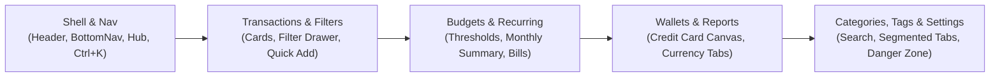

# PocketWise — UI Modernization & Handover Documentation
> **สำหรับ AI Agent ทุกตัว (Read-First Handover Guide)**:  
> เอกสารฉบับนี้เป็น **Source of Truth (SoT) สรุปงานปรับปรุง UI/UX ทั้งหมด** ที่ได้ดำเนินการเสร็จสิ้น ทดสอบ E2E และ Deploy ขึ้นสู่ Production เรียบร้อยแล้ว เพื่อให้ AI Agent ตัวใหม่สามารถเข้ามาทำงานต่อได้ทันที **โดยห้ามรื้อทำใหม่ หรือทำซ้ำในสิ่งที่ปรับปรุงไปแล้วโดยเด็ดขาด**

---

## 📌 1. วัตถุประสงค์ (Purpose)
ในระหว่าง PR #50 ถึง #54 ระบบ PocketWise ได้รับการยกเครื่องส่วนติดต่อผู้ใช้ (Frontend UI & UX Modernization) ครบทุกฟังก์ชันหลักตามมาตรฐานระดับสากล โดยเน้น:
1. **Mobile-First Experience**: หน้าจอมือถือใช้งานง่ายด้วยนิ้วโป้ง (Thumb Zone), มี BottomSheet แทน Modal, และ Drawer รวมเมนู
2. **Tactile Feedback & Visual Polish**: ดีไซน์ Glassmorphism รองรับ Dark/Light theme, Animation นุ่มนวล, และปุ่มมีสถานะ `isLoading` ป้องกันการกดซ้ำ
3. **Type-Safety & Consistency**: บังคับใช้ พ.ศ./ค.ศ. มาตรฐาน, เวลาไทย `Asia/Bangkok`, ไม่มี Native dialogs/pickers

---

## 🎨 2. มาตรฐาน UI/UX กลางของระบบ (Established UI/UX Standards)

| หมวดหมู่ | มาตรฐานที่ implement แล้ว | รายละเอียด & ตำแหน่ง Component |
| :--- | :--- | :--- |
| **Glassmorphism Theme** | Dark & Light Theme | คลาส `.pw-glass`, `.pw-card`, `.pw-ambient-bg` ใน `globals.css` โดยใช้ Design Tokens `--pw-*` (ห้ามใช้สี arbitrary ทับ design system) |
| **Dialog / Modal** | Desktop Modal ↔ Mobile BottomSheet | ใช้ `@/components/ui/bottom-sheet` อัตโนมัติ: บน Desktop (`sm` ขึ้นไป) เป็น Centered Dialog ส่วนบน Mobile (`< sm`) แสดงเป็น BottomSheet สไลด์จากล่าง |
| **BottomSheet Buttons** | ปุ่ม Confirm บน / Cancel ล่าง | `BottomSheetFooter` จัด layout `flex-col` โดยปุ่ม Confirm (ยืนยัน/บันทึก) อยู่ด้านบน และ Cancel (ยกเลิก/ปิด) อยู่ด้านล่างเพื่อความสะดวกของผู้ใช้มือถือ |
| **Button Loading State** | มี Spinner + Disabled เสมอ | ทุกปุ่ม Action ที่ส่ง request ไปยัง API ต้องมี prop `isLoading` หรือแสดง `<Loader2 className="animate-spin" />` พร้อมปิดการคลิกซ้ำ |
| **Alert & Confirm Dialog** | ห้ามใช้ `window.confirm()` / `alert()` | ใช้ `@/components/ui/alert-dialog` (`AlertDialog`, `ConfirmDialog`) เท่านั้น เพื่อความสวยงามและคงสไตล์ Glassmorphism |
| **Feedback Toasts** | Sonner Toasts | ใช้ `toast.success(...)` และ `toast.error(...)` จาก `sonner` ในทุก Action สำคัญ (ห้ามทำงานเงียบโดยไม่มี Feedback) |
| **Date & Time** | ค.ศ. เท่านั้น + เวลาไทย UTC+7 | ใช้ `@/components/ui/date-input` (`DateInput`, `DateTimeInput`) และฟอร์แมตผ่าน `@/lib/date-utils` (`formatDisplayDate`, `formatDisplayDateTime`) ห้ามใช้ Native `<input type="date">` เด็ดขาด |
| **Dropdown / Select** | ห้ามใช้ Native `<select>` | ใช้ `@/components/ui/select` จาก shadcn เสมอ เพื่อป้องกันปัญหา White-on-White บนระบบปฏิบัติการมือถือ |
| **Filter Drawer** | ยุบเงื่อนไขตัวกรองเมื่อมีหลายตัว | หากมีเงื่อนไข $\ge 3$ ตัว ให้ใช้ปุ่ม "ตัวกรอง" พร้อม Badge จำนวนตัวกรองที่เลือก แล้วเปิดเป็น Drawer/BottomSheet |
| **Skeleton Loading** | Shimmer เสมอ | ห้ามใช้ข้อความ `
กำลังโหลด...
` โดดเดี่ยว ให้ใช้ `@/components/shared/Skeletons.tsx` เลียนแบบ UI จริง |
| **Animation** | Motion (`motion/react`) | ใช้ `AnimatedList`, `AnimatedNumber`, `PageTransition` และ micro-interactions `hover:scale-102 active:scale-98` |

---

## 📱 3. สรุปรายละเอียดหน้าจอที่ได้รับการปรับปรุงแล้ว (Modernized Views)

### 3.1 ระบบ Navigation & Shell (`DashboardShell.tsx`)
- **Global Command Palette (`Ctrl+K` / `Cmd+K`)**:
  - ไฟล์: `src/components/shared/CommandPalette.tsx`
  - รองรับการค้นหาและนำทางด่วนไปได้ทุกหน้าจอ (15+ routes)
  - Quick Actions: บันทึกรายการใหม่, สแกนสลิป, สร้างงบประมาณ, สลับธีม Dark/Light
  - มีปุ่ม Shortcut แสดงบน Header ให้คลิกเปิดได้
- **Clean Sidebar Header & Integrated Avatar Bell**:
  - ตัดกล่องข้อความทักทายเดิม `"สวัสดี คุณ..."` ออกจาก Sidebar ทั้งบน Desktop และ Mobile Drawer เพื่อประหยัดพื้นที่แนวตั้ง
  - ย้ายกระดิ่งแจ้งเตือน (`NotificationBell`) เข้าไปรวมอยู่ใน User Profile Card ทางด้านขวาประกบคู่กับ Avatar และ Role Badge ของผู้ใช้โดยตรง
- **Mobile Navigation & Grouped Menu Shortcut Cards**:
  - Header ซ้ายมีปุ่มย้อนกลับ (`ChevronLeft`) สำหรับจอมือถือ
  - Bottom Navigation Bar 4 ปุ่มหลัก + ปุ่ม Quick Action (`+`) ตรงกลาง
  - **Mobile Drawer ยกเครื่อง All Menus**: เปลี่ยนจากรายการ Text List แนวตั้งแบบเดิม มาเป็น **Grouped 2-Column Shortcut Cards** (`grid grid-cols-2 gap-2`) พร้อมกรอบ Glassmorphism, กล่องไอคอนสีสดตามประเภท (`MobileMenuCardItem`), ข้อความชัดเจน, และ Active Dot แสดงสถานะหน้าปัจจุบัน แบ่งเป็น 4 กลุ่มหลัก:
    1. **ธุรกรรม & การเงิน**: รายการธุรกรรม, โอนเงินระหว่างบัญชี, นำเข้าสลิป & บิล, บัญชีธนาคาร, บัตรเครดิต & รอบบิล
    2. **วางแผน & วิเคราะห์**: งบประมาณ, รายการประจำ, รายงานการเงิน
    3. **จัดการ & ตั้งค่า**: หมวดหมู่รายรับจ่าย, แท็กรายการ, จัดหมวดอัตโนมัติ, ตั้งค่าและโปรไฟล์
    4. **ผู้ดูแลระบบ (Admin)**: รวมเมนูฝั่งแอดมิน 9 หน้าจอ พร้อม Accordion ยุบ/ขยายได้

### 3.2 ธุรกรรมและการค้นหา (`/transactions`)
- **ไฟล์หลัก**: `src/features/transactions/`
- **Mobile Card View**: แสดงการ์ดธุรกรรมพร้อมไอคอนหมวดหมู่, สีตามประเภท (เขียว/แดง/ฟ้า), และ Badge แท็ก
- **Filter Drawer (`FilterDrawer.tsx`)**:
  - Badge แสดงจำนวนตัวกรองที่เลือก
  - Month Picker สำหรับเลือกเดือน/ปี
  - Quick Type Switcher (ทั้งหมด / รายจ่าย / รายรับ / โอน)
  - Sticky Footer ปุ่ม "ล้างตัวกรอง" และ "นำไปใช้"
- **Form บันทึกธุรกรรม (`TransactionForm.tsx`)**:
  - รองรับทั้ง Modal (Desktop) และ BottomSheet (Mobile)
  - Color Badge สำหรับแท็กที่มีสีจริง
  - ปุ่มบันทึกมีสถานะ Loading (`isLoading`) ชัดเจน

### 3.3 งบประมาณ (`/budgets`)
- **ไฟล์หลัก**: `src/features/budgets/BudgetView.tsx`, `BudgetCard.tsx`
- **Progress Bar อัจฉริยะ**:
  - แจ้งเตือนสีส้มเมื่อแตะ 80% และสีแดงเมื่อเกิน 100%
  - แสดงยอดคงเหลือ และงบแนะนำที่ใช้ได้ต่อวัน (Daily Allowance)
- **Responsive Layout**: Desktop เป็น Grid Card สวยงาม, Mobile เป็นการ์ดกระชับที่เลื่อนดูง่าย

### 3.4 รายการประจำ (`/recurring`)
- **ไฟล์หลัก**: `src/features/recurring/RecurringView.tsx`
- **Monthly Commitment Summary Card**:
  - สรุปภาระรายจ่าย/รายรับประจำที่จะเกิดขึ้นในเดือนนี้ (Projected Monthly Commitments)
- **Upcoming Bills Alert Banner**:
  - แจ้งเตือนบิลที่จะครบกำหนดภายใน 7 วันข้างหน้า พร้อม Badge จำนวนวันนับถอยหลัง
- **Status Switcher**: สลับ Active / Paused ได้ในคลิกเดียว พร้อม Toast Feedback

### 3.5 บัญชี & บัตรเครดิต (`/bank-accounts`, `/credit-cards`)
- **ไฟล์หลัก**: `src/features/accounts/`, `src/features/credit-cards/`
- **Visual Credit Card Canvas**:
  - การ์ดจำลองบัตรเครดิตดีไซน์ Metallic/Glassmorphism Gradient
  - แสดงวันตัดรอบบิล, วันครบกำหนดชำระ, และวงเงินคงเหลือ
- **Bank Account Balance Cards**: แสดงยอดเงิน, คัดลอกเลขบัญชีได้ในคลิกเดียว

### 3.6 รายงานและสถิติ (`/reports`)
- **ไฟล์หลัก**: `src/features/reports/ReportsView.tsx`
- **Recharts Integration**: กราฟแท่ง, กราฟเส้น, และ Donut Chart ใช้โทนสี `--pw-*`
- **แยกตามสกุลเงิน (Multi-Currency Isolation)**: แยกดูตาม THB, USD ฯลฯ ไม่รวมยอดข้ามสกุลเงิน
- **Mobile View**: ปรับเป็น Tabbed Segmented Breakdown ทำให้อ่านง่ายบนจอมือถือ

### 3.7 หมวดหมู่ & แท็ก (`/categories`, `/tags`)
- **ไฟล์หลัก**: `src/features/categories/CategoriesView.tsx`, `src/features/tags/TagsView.tsx`
- **Segmented Tabs**: สลับดู "รายจ่าย", "รายรับ", และ "ทั้งหมด" ได้สะดวกรวดเร็ว
- **Instant Search**: ช่องค้นหาแบบ Real-time กรองชื่อหมวดหมู่และแท็กทันทีที่พิมพ์
- **Color Preview**: จุดสี (Dot preview) และ Contrast badge ชัดเจน

### 3.8 การนำเข้าสลิป & OCR (`/imports`)
- **ไฟล์หลัก**: `src/features/imports/SlipImportTab.tsx`
- **Tactile Dropzone**: ลากวางหรือแตะเพื่อเลือกรูปสลิป มี Visual Hover/Drag State
- **OCR Progress Steps**: แสดงขั้นตอนการสแกนด้วย AI (อัปโหลด ➔ สแกน QR ➔ ตรวจจับยอด ➔ สำเร็จ)
- **Slip Receipt Preview Card**: แสดงข้อมูลสรุปยอดเงิน, วันที่, บัญชีผู้โอน-รับ, และแจ้งเตือนหากเป็นสลิปซ้ำ

### 3.9 การตั้งค่า & ความปลอดภัย (`/settings`)
- **ไฟล์หลัก**: `src/features/settings/SettingsView.tsx`
- **Glassmorphism Sections**: แยกหมวดหมู่ Profile, Preferences, Active Sessions, และ Danger Zone
- **Danger Zone**: มีกรอบสีแดงชัดเจน พร้อมระบบ **Double Confirmation Dialog** ป้องกันการเผลอลบข้อมูลหรือบัญชีโดยไม่ตั้งใจ
- **Active Sessions**: ดูอุปกรณ์ที่ล็อกอินอยู่และกด Revoke เซสชันที่ไม่ต้องการได้ทันที

---

### 3.10 ฟีเจอร์ PWA, Quick Math & Monthly Report Export
- **Monthly Report Export Dialog (`/reports`)**:
  - เปลี่ยน Modal ส่งออกรายงานให้เป็น `BottomSheet` มาตรฐาน Glassmorphism
  - เพิ่มตัวเลือกส่งออก "เลือกรายเดือนเฉพาะ (Selected Month)" พร้อม Dropdown เลือกเดือนย้อนหลัง เพื่อดาวน์โหลด CSV ภาษาไทย (UTF-8 with BOM) สรุปเฉพาะเดือนที่ต้องการได้ทันที
- **Progressive Web App (PWA & Offline Banner)**:
  - เพิ่ม `src/app/manifest.ts` รองรับ Standalone display, App Shortcuts (`จดด่วน`, `สแกนสลิป`, `รายงาน`), และ Categories
  - รองรับ Apple Web App meta tags ใน `layout.tsx`
  - เพิ่ม `OfflineBanner.tsx` แสดงแถบแจ้งเตือนทันทีเมื่อหลุดการเชื่อมต่ออินเทอร์เน็ต และแจ้งเตือนเมื่อกลับมาออนไลน์
  - เพิ่มการ์ด "ติดตั้งเป็นแอปมือถือ" ใน Mobile Drawer
- **Quick Math ในช่องจำนวนเงิน**:
  - สร้าง `src/lib/math-parser.ts` คำนวณนิพจน์คณิตศาสตร์พื้นฐาน (`+`, `-`, `*`, `/`) ปลอดภัย 100% (No `eval()`)
  - อัปเดต `NumberInput.tsx` ให้รองรับ `enableQuickMath` แสดง Badge ผลลัพธ์สด (`= 100฿`) และประเมินค่าเป็นตัวเลขทันทีเมื่อกด Enter หรือ Blur
- **Global Keyboard Shortcuts บน Desktop**:
  - กด `N` เพื่อเปิดหน้าต่างสร้างรายการใหม่ทันที
  - กด `?` เพื่อเปิดหน้าต่างสรุปปุ่มลัดคีย์บอร์ดทั้งหมด
  - กด `Esc` ปิด Popup / Drawer

### 3.11 การปรับปรุงโครงสร้าง Sidebar และ Mobile Menu Cards ล่าสุด
- **Sidebar Profile Card & Avatar Notification Bell**:
  - ลบข้อความทักทายเดิม `"สวัสดี คุณ..."` ออกจากส่วนบนของแถบ Sidebar ทั้งในโหมด Desktop และ Mobile Drawer เพื่อประหยัดพื้นที่แนวตั้ง
  - ย้ายกระดิ่งแจ้งเตือน (`NotificationBell`) เข้าไปรวมอยู่ใน User Profile Card บริเวณขวาบนติดกับ Avatar ของผู้ใช้โดยตรง ดูเป็นสัดส่วนระดับ Modern FinTech
- **All Menus แบบ Grouped 2-Column Shortcut Cards บน Mobile**:
  - เปลี่ยนส่วนเมนูทั้งหมด (All Menus) บนหน้าจอมือถือ (Drawer) จากรายการข้อความแนวตั้งแบบเดิม ให้กลายเป็น **การ์ดช็อตคัท 2 คอลัมน์ (`grid grid-cols-2 gap-2`)** ที่มีกล่องไอคอนสีสด สไตล์เดียวกับแถบ Shortcut ด้านบน
  - จัดกลุ่มเมนูอย่างเป็นระเบียบ 4 กลุ่ม เพื่อให้ผู้ใช้ค้นหาและกดเลือกด้วยนิ้วโป้งได้ง่าย:
    1. **ธุรกรรม & การเงิน**: รายการธุรกรรม, โอนเงินระหว่างบัญชี, นำเข้าสลิป & บิล, บัญชีธนาคาร, บัตรเครดิต & รอบบิล
    2. **วางแผน & วิเคราะห์**: งบประมาณ, รายการประจำ, รายงานการเงิน
    3. **จัดการ & ตั้งค่า**: หมวดหมู่รายรับจ่าย, แท็กรายการ, จัดหมวดอัตโนมัติ, ตั้งค่าและโปรไฟล์
    4. **ผู้ดูแลระบบ (Admin)**: เมนูฝั่งแอดมิน 9 หน้าจอ รวมไว้ในกล่อง Accordion ที่เปิด/ปิดได้ตามต้องการ
  - มีจุด Indicator แสดงสถานะหน้าปัจจุบัน (Active Page Indicator Dot) ทุกการ์ด

### 3.12 การยกระดับ UI บนหน้าจอมือถือ (Transfers, Categorization, Imports & Admin)
- **โอนเงินระหว่างบัญชี (`/transfers`)**:
  - เปลี่ยนการ์ดประวัติเป็น **Visual Route**: กล่องบัญชีต้นทาง (ไอคอนธนาคาร) ➔ ลูกศรบอกทิศทาง ➔ กล่องบัญชีปลายทาง (ไอคอนกระเป๋าเงิน)
  - เพิ่มปุ่ม **"โอนอีกครั้ง" (Quick Repeat Transfer)** กดโอนซ้ำรายการเดิมได้ทันทีด้วย 1 แตะ
  - เพิ่มการ์ดสรุปยอดโอนรวมและจำนวนรายการด้านบน
  - ใช้ `BottomSheetFooter` (Confirm บน, Cancel ล่าง) และ `formatDisplayDateTime` ตาม Master Rules
- **จัดหมวดหมู่อัตโนมัติ & ร้านค้า (`/categorization`)**:
  - เพิ่ม **Segmented Tabs** สลับดูระหว่าง "กฎจัดหมวด (Rules)" และ "ร้านค้า (Merchants)" ไม่ต้องเลื่อนจอยาว
  - เพิ่ม **Instant Search Box** ค้นหาชื่อกฎ คำค้น ร้านค้า หรือหมวดหมู่ได้ทันที
  - แปลงรายการเป็น Mobile Card ที่มีภาพ visual ชัดเจน: เมื่อเงื่อนไขตรง ➔ จัดลงหมวดหมู่อะไร พร้อมปุ่มแก้ไข/ลบ
  - ใช้ `BottomSheetFooter` และ `enableQuickMath`
- **นำเข้าข้อมูล & ประวัติ Import (`/imports`)**:
  - แท็บด้านบนปรับเป็น Glassmorphism Segmented Tab Bar รองรับจอมือถือ
  - ในแท็บ **Import Jobs**: เพิ่ม **Mobile Card List View** (`md:hidden`) สรุปประเภทงาน, ชื่อไฟล์, วันที่เวลา, สถิติ (ทั้งหมด/นำเข้า/ซ้ำ), สถานะ และปุ่ม "ตรวจสอบและยืนยันรายการ" ขนาดเต็มปุ่มกดง่าย
  - ใช้ `BottomSheetFooter` ในตัวกรอง
- **หน้าผู้ดูแลระบบ Admin (`/admin/users`, `/admin/security-events`)**:
  - เพิ่ม **Mobile User Cards**: แสดง Avatar, ชื่อ, อีเมล, บทบาท, สถานะอีเมล/บัญชี และปุ่ม Quick Action (ตรวจสอบ, ยกเลิกระงับ, ระงับบัญชี)
  - เพิ่ม **Mobile Security Event Cards**: แสดง Event Badge, เวลา, เป้าหมาย, ผู้กระทำ, IP และปุ่มดู JSON รายละเอียด
  - กำจัดปัญหา Horizontal Overflow บนมือถือ 100%

- **กล่องแจ้งเตือน (`NotificationBell.tsx`)**:
  - บน Mobile (`< sm`): แปลง Popover ให้กลายเป็น **BottomSheet เต็มจอจากขอบล่าง** ใช้งานสะดวกด้วยนิ้วโป้ง พร้อมปุ่ม "อ่านทั้งหมด" และ Tab สลับ "ทั้งหมด" / "ยังไม่อ่าน"
  - ใช้ helper กลาง `formatRelativeTime` จาก `@/lib/date-utils` แทนการคำนวณซ้ำ
- **มาตรฐานลำดับปุ่มและสถานะการลบบนมือถือ (Mobile Button Hierarchy & Deletion Loading)**:
  - **ลำดับปุ่มยืนยัน/ยกเลิก (`AlertDialog` / `ConfirmDialog`)**: บนหน้าจอโทรศัพท์มือถือ (`< sm`) ปุ่มยืนยัน/ลบ (`AlertDialogAction`) ถูกบังคับให้อยู่ข้างบนเสมอ (`order-1`) และปุ่มยกเลิก (`AlertDialogCancel`) อยู่ข้างล่างเสมอ (`order-2`) เพื่อความสะดวกและสอดคล้องกับทั้งระบบ
  - **Deletion Loading Feedback**: ทุกการกดลบรายการ (Transactions, Budgets, Recurring, Rules ฯลฯ) มี Loading State ชัดเจน (Spinner / Disabled / Toast) ทันทีหลังกดยืนยัน ไม่ปล่อยให้หน้าจอนิ่งค้างระหว่างรอการตอบกลับจาก API
- **หน้าภาพรวมแอดมิน (`/admin/overview`)**:
  - ปรับการ์ดสรุป Operations (งานนำเข้าข้อมูล และ เหตุการณ์ความปลอดภัย 24 ชม.) ให้เป็น Responsive Grid (`grid-cols-2 sm:grid-cols-4`) ป้องกันข้อความภาษาไทยตัดคำเบียดกันบนจอมือถือ
  - แถบโหมดปรับปรุงระบบ (Maintenance Mode) จัดปุ่มเต็มความกว้างบนมือถือ แตะง่าย
  - ปุ่มรีเฟรชข้อมูลมีแอนิเมชัน `RefreshCw` หมุนขณะโหลดข้อมูล

## 📜 4. ประวัติการ Deploy และ PR ที่เกี่ยวข้อง (PR History)

| Pull Request | Commit | รายละเอียดสำคัญ |
| :---: | :---: | :--- |
| **PR #50** | `9962f27` | Implement 9 UX Enhancements: Glassmorphism, Animation tokens, Responsive themes |
| **PR #51** | `eedb8a9` | Filter Drawer UX: Month picker, sticky footer, quick type switcher |
| **PR #52** | `847bb71` | Mobile-first transactions, reports, wallet cards, budgets, and button loading |
| **PR #53** | `195e570` | Mobile hub drawer, recurring monthly summary, upcoming 7-day bills banner |
| **PR #54** | `a870277` | Global Command Palette (Ctrl+K), Categories tabs & search, Tags search, Settings polish |
| **PR #55** | `13cf5e5` | Mobile UI Overhaul: Transfers, Categories, Imports, Admin Users & Events, Notification Drawer, Admin Overview, Deletion Loading, and Mobile Button Hierarchy |

*สถานะปัจจุบัน: Branch `develop` พร้อมสำหรับตรวจสอบและ Merge เข้าสู่ `main`*

---

## 🤖 5. คำแนะนำสำหรับ AI Agent ตัวถัดไป (Guidelines for Next AI Agent)

1. **ห้ามรื้อทำใหม่ (Do Not Re-invent)**:
   - ตรวจสอบ component ใน `src/components/ui/` และ `src/features/` ก่อนเสมอ
   - หากผู้ใช้ขอปรับปรุง UI ให้ต่อยอดจากฟังก์ชันเดิมที่มีอยู่แล้วตามตารางในข้อ 3
2. **รักษา Master Rules เสมอ**:
   - ปฏิบัติตามกฎ 8 ข้อใน Root [`/AGENTS.md`](file:///d:/Projects/PocketWise/AGENTS.md) เสมอ
   - ห้ามลง Package ใหม่โดยไม่ได้รับอนุญาต
   - ตรวจสอบว่า Build ผ่าน 100% (`dotnet build` และ `npm run build`)
3. **ฟังก์ชันที่แนะนำให้ทำต่อในอนาคต (Recommended Next Steps)**:
   - **Offline PWA Data Sync**: Service Worker แคชหน้าจอหลักและคิวสร้างรายการออฟไลน์สำหรับซิงค์อัตโนมัติเมื่อกลับมาออนไลน์
   - **Excel / PDF Export**: เพิ่มตัวเลือกส่งออกรายงานในรูปแบบ Excel (`.xlsx`) หรือ PDF พร้อมชาร์ต
   - **Web Push Notifications**: ระบบ Web Push สำหรับแจ้งเตือนงบประมาณใกล้เกินและบิลประจำใกล้ครบกำหนด
